# 代码阅读路线: 主流程, 分支流程与类 / 函数跳转

> 核对日期: 2026-10-08, 核对到分支 `feat/sub-agent` 的工作区 (按功能分包
> ADR-0053; 工具系统与权限模块完全仿照 Claude Code, ADR-0054 / ADR-0055; auto 模式的
> 安全分类器, ADR-0058; 主循环按 ADR-0049 / ADR-0051).
> 本文描述**实际调用链**; ADR 描述设计背景. 遇到两者不一致, 先沿本文给出的函数查源码,
> 不把 ADR 的 Proposed / Accepted 状态, 模块开头的历史注释当作实现完成证明.

## 0. 阅读方法与流程索引

这份文档面向需要通读, 维护和排障的人. 目标是能从一个用户操作追到实际执行的函数,
解释它在哪个分支停止, 改了什么状态, 向谁返回什么结果.

图中的矩形是函数调用或明确标注的状态动作, 菱形是分支判定; 实线表示调用 / 控制流,
虚线表示事件通知, 注入或数据传递. `类名.方法名` 可以直接在编辑器中搜索; 模块级函数
用 `模块名.函数名` 区分同名入口. 每张图只展开一个子流程, 图上的章节编号是继续下钻的位置.
这些图表达调用顺序, 不表示所有节点都在同一个线程中.

| 阅读顺序 | 主流程 | 展开的分支 |
|---|---|---|
| §1 | 分层与组合根 | 对象生命周期, 数据身份, 依赖方向 |
| §2 | 启动与项目激活 | Web / TUI, 令牌握手, 锁冲突, 沙箱探测, 退出 |
| §3 | 一轮对话 | 消息发送, 后台执行, 外层记-跑-记, 异常与终态 |
| §4 | 内层循环 | 每次现组材料, 规则表与五个时机, 一批工具整批交出去, 收工具, 格式纠错, 顺序约束 |
| §5 | 上下文 | 稳前变后的顺序, 每次现组, 窗口淘汰, 摘要, 超窗恢复, 工作区变化 |
| §6 | 工具执行链与权限裁决 | 分批并发, 七步执行链, 裁决顺序, Bash 与文件工具的裁决, 审批卡片与建议, auto 模式的分类器 |
| §7 | 人机交互与取消 | 审批, 提问, 作答校验, 跳过, 取消竞态, 计划评审 |
| §8 | 内置工具 | Read / Edit / Write / Glob / Grep / LSP / Bash, WebSearch / WebFetch, 计划, 待办, 记忆, 结果落盘 |
| §9 | LLM 网关 | 选模, 流式 / 非流式, 首包前重试, 首包后中断, 结构化输出, 缓存 |
| §10 | 文件历史与回退 | 改前备份, 每批一个快照, /rewind |
| §11 | 事件与前端 | 总线, 磁盘过程记录, 快照水位, SSE 续传, 作用域隔离, 终态对账 |
| §12 | 会话与配置 | 惰性持久化, 续写, 墓碑删除, 模型重载, 模式, 额外工作目录, 按项目分页列会话 |
| §13 | 排障与核验 | 日志定位, 常见误读, 设计与当前代码边界 |
| §14 | 沙箱配置与装配 | 配置解析与覆盖, Provider 自测, 单次执行, 网络与文件边界, Maven 排障 |
| 附录 A | HTTP 路由导航 | 每个路由跳到定义函数 |
| 附录 B | TUI 命令导航 | 命令处理器及共用服务 |

### 0.1 本次纠正的旧口径

旧版文档里的历史叙述不再保留为当前行为:

- 源码不再分 `domain/` `application/` `infrastructure/` `interfaces/` 四层 (ADR-0053).
  `src/forgecli/` 下是 21 个按功能命名的包, 依赖方向由 `scripts/check_arch.py` 的 11 层
  拓扑守着, 见 §1.1. 旧文档里 `interfaces/web/`, `application/agent_loop/` 一类路径按
  §1.1 的表对照.
- 工具系统与权限模块是 Claude Code 的直接移植 (ADR-0054 / ADR-0055): `Tool` 协议,
  七步执行链, 按 `is_concurrency_safe` 分批, 规则 `Bash(git commit:*)` / `Edit(src/**)`,
  六档模式. 旧文档的 `ToolSpec` / `ToolPlan` / `AnalysisFindings` / `PolicyEngine` /
  `ExecutionAuthorization` / `ToolRequestCoordinator` / `ToolRuntime` / 能力上界 / 目标
  封闭度 / 学习规则 / 恢复点 (`WorkspaceMutationCoordinator`, `RecoveryService`) 全部
  不存在了, 见 §6, §10.
- `runtime/tool_wiring.py::build_tool_stack()` 注册 17 个内置工具实例: 16 个可用工具与
  默认禁用的开发测试工具 `TEST` (可用性由 `is_enabled()` 决定). 新增联网工具 `WebSearch` /
  `WebFetch`; 它们各自有网络获取实现, 不属于外部 MCP 工具池. 其余工具使用 `Read` `Edit`
  `Write` `Glob` `Grep` `LSP` `Bash` `TodoWrite` `AskUserQuestion`, 加自有的 `plan_read`
  `plan_write` `todo_set_status` `memory_write` `memory_forget`. `fs_read` `search_text` `fs_apply_patch`
  `shell_run` `ask_user` `todo_write` 只作为 `aliases` 供旧规则与旧记录查找, `artifact_read`
  没有了 (超长结果落盘成文件, 模型用 `Read` 取), 见 §8.
- 模式是一轴: `default` / `accept_edits` / `plan` / `bypass_permissions` / `dont_ask` /
  `auto`. 旧的"隔离档 x 审批档"两轴 `SessionMode` 与 `manual` / `full_access` 预设名
  只剩解析兼容 (`parse_permission_mode`). `auto` 现在是分类器模式 (ADR-0058), 与旧预设
  "围栏内自动"同名不同义; 后者的用例由沙箱设置 `autoAllowBashIfSandboxed` 覆盖, 见 §6.2, §6.6.
- 循环把一批工具**整批**交给执行链 (`execute(tuple)`), 不再一个一个 `execute(request)`;
  分批与并发在执行链里, 见 §4.2.
- 审批不再是 `ApprovalService` + `ApprovalRequest`: `security/interactive.py::make_can_use_tool`
  在裁决说 ask 时经 `HumanPromptService` 摆卡片, 卡片按钮来自决定里的 `suggestions`,
  见 §6.5, §7.1.
- `tests/` 现在有少量 Python 单元 / 集成用例 (包括子 Agent、结构化输出与联网工具),
  `web/tests/` 有前端脚本用例. 旧文档里"`tests/agent_loop/` 38 个用例"的说法作废;
  实际门禁内容以当前 `Makefile` 的 `ci` 目标为准, 见 §13.3.
- 终端入口是 `forge --cli`, 代码在 `tui/`; 没有 `forge cli` 子命令. Web 路由在
  `web/routers/`, `web/app.py` 负责装配, 中间件在 `web/security.py`.
- 没有工作区监控. ADR-0047 (文件事件 / 快照对比) 已被 ADR-0056 决策 14 取代: 只看模型读
  过的文件 (`FileStateCache`) 的 mtime, 见 §5.4.

### 0.2 从源码启动

```bash
poetry install
make web-install
make web-build
poetry run forge
```

默认 Web 端口由 `web/server.py::DEFAULT_PORT` 定义 (当前为 8765), 启动后使用终端打印的
一次性链接. 源码运行需要构建静态资源; `create_app()` 在静态资源目录缺失时直接报错.
终端路径用 `poetry run forge --cli`, 要求可交互的 TTY. `--allow-full-access` 两条路都认,
它决定的只是 `bypass_permissions` 这一档在不在菜单里 (§12.5).

## 1. 先建立骨架: 层, 对象和身份

源码根是 `src/forgecli/`. 先读 `scripts/check_arch.py` (层与互斥表), 再看
`docs/adr/2026-09-15-0053-按功能分包去掉四层.md` (附录有旧路径到新路径的对照表),
`docs/adr/README.md`. 架构检查约束依赖方向, 组合根决定抽象的实际实现.

### 1.1 类之间怎么接起来

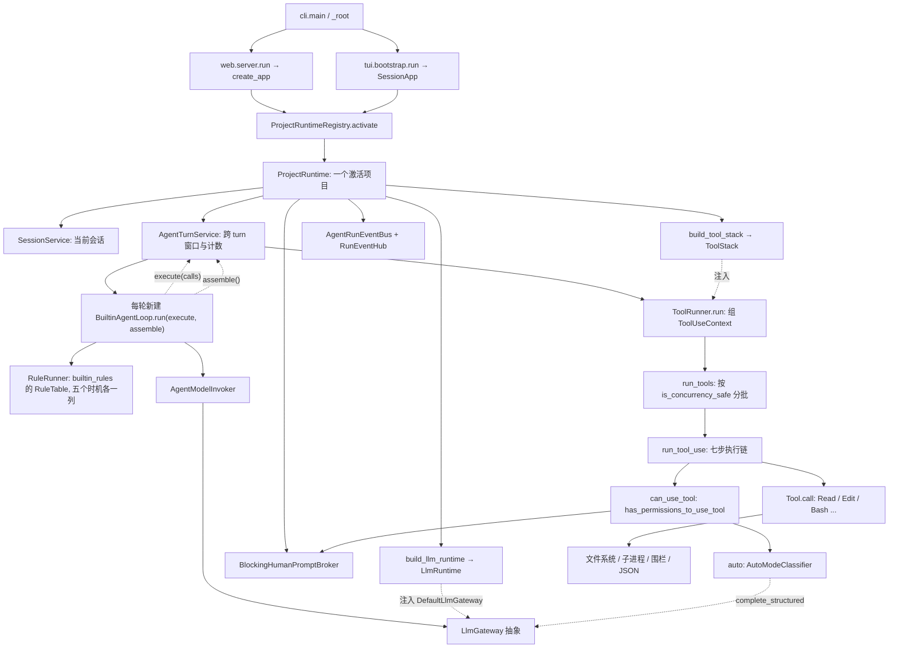

| 包 (层) | 主要职责 | 阅读时要守住的边界 |
|---|---|---|
| `common/`, `human_interaction/` (L0) | 错误, 取消, JSON IO, 日志; 人机提示的 `HumanPrompt` / `HumanPromptService` | 什么都不认识 |
| `core/`, `memory/` (L1) | 跨包词汇: 消息, 轮次, 模型请求 / 响应, `permissions.py` (模式, 规则, 决定, `ToolPermissionContext`), `app_state.py`, `tool/` (`Tool` 协议, `FileStateCache`, `ToolRunObserver`), `execution/` (围栏, 画像); 记忆 | 不访问网络; 记忆不参与裁决 |
| `settings/`, `project/`, `prompt/`, `workspace/`, `planning/` (L2) | 配置键与存储, 项目身份与锁, 提示词正文 (`prompts.py`), 工作区快照与忽略, 计划与待办 | 模型可读正文只从 `prompt/prompts.py` 出 |
| `llm/`, `security/` (L3) | 网关, 适配器, 选模; 权限裁决 (`permissions.py`), 规则解析与匹配, 文件路径裁决, 设置文件的 `permissions` / `sandbox` / `autoMode` 段, auto 模式分类器 | `security` 只认识 `core` 里的 `Tool` 协议, 不认识具体工具; 也不认识 `llm`, 分类器的模型调用由组合根以函数注入 |
| `conversation/`, `execution/`, `session/` (L4) | 组上下文与维护窗口; 命令执行器与围栏 provider; 会话事件与快照 | 上下文组装不参与裁决 |
| `tools/` (L5) | 工具池, 执行链, 分批, 结果落盘, 文件历史, `ToolRunner`; `builtin/` 每个工具一个目录 | 只发 `ToolRunObserver`, 不认识事件总线 |
| `agent/` (L6) | 内层循环 `loop/` (控制流在 `builtin_loop.py`, 判断在 `rules/`), 外层 `turn_service.py`, 事件总线与事件种类, 过程落盘 | 循环只会调外层交进来的两个函数 |
| `runtime/` (L7) | 组合根: `project_runtime.py`, `tool_wiring.py`, `llm_wiring.py`, 事件 hub, 提示 broker | 同时认识抽象和实现, 负责接线 |
| `tui/` (L8), `web/` (L9), `cli.py` (L10) | 用户输入, 协议, 展示 | 共用同一个 `ProjectRuntime` 业务入口 |
| `web/src/` | React 控制面 | HTTP 查权威状态, SSE 展示过程 |

### 1.2 生命周期与身份不要混用

| 名称 | 创建方 | 生命周期 / 作用 |
|---|---|---|
| `project_id` / 工具栈里的 `workspace_id` | `ProjectService.trust()` | 项目分区; 当前装配中二者指同一项目身份 |
| `ProjectRuntime` | `ProjectRuntimeRegistry.activate()` | 项目激活到切换 / 关闭; 持有进程锁 |
| `session_id` | `SessionService.start()` | 一次会话, 可持久化后续写 |
| `run_id` | `ProjectRuntime.start_turn()` | 一次后台线程执行, 不等于 turn_id |
| `TurnIdentity(session_id, turn_id)` | `AgentTurnService.handle_user_message()` | 会话内轮次; turn_0001 可在不同会话重复 |
| `request_id` | `BuiltinAgentLoop._build_request()`; 摘要, 标题, 分类器各自另起 | 一次模型请求 |
| `tool_call_id` (执行链里叫 `tool_use_id`) | 模型协议 | assistant tool_calls 与 tool result 配对; 观察事件, 落盘文件名, 审批卡片都带它 |
| `prompt_id` | 审批 `perm_<12 hex>` (`security/interactive.py`), 提问 `uuid` (`AskUserQuestionTool`) | 一张待答卡片; broker 另绑定内部 turn 代次 |
| 文件历史快照 `message_id` = `"{turn_id}#{批次序号}"` | `ToolRunner.run()` | 一批工具执行之前工作区的样子, `/rewind` 的目标 |
| `stream_id:cursor` | `RunEventHub` / `ResumePoint` | 一个事件流实例中的位置; 跨实例不可直接续用 |

`SessionService` 的会话记录, `runs.jsonl` 的过程记录, 运行日志是三种数据, 不能因为都包含
turn_id 就互相替代. 尤其 `runs.jsonl` 不负责重建模型上下文. 会话级可变状态
(`AppState`: 权限上下文, 沙箱设置, 分类器拦截计数) 由 `runtime/tool_wiring.py::AppStateHolder`
独家持有, 工具与权限层经 `ToolUseContext.get_app_state()` / `set_app_state()` 读写.

## 2. 主流程: 启动, 激活和退出

源码入口: `cli.py`, `web/server.py`, `web/app.py`, `tui/bootstrap.py`,
`runtime/project_runtime.py`.

### 2.1 命令入口分支

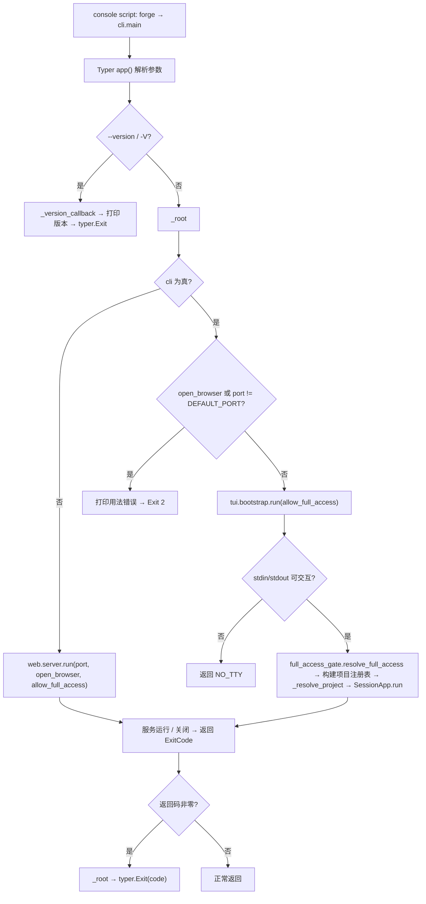

`--version` 是 eager callback, 目的在于版本查询直接结束, 不继续建立服务.
`--cli` 与端口的兼容检查实际比较的是数值: 显式给默认端口仍等于默认值, 不能把这段
描述成"能识别任何显式出现的 --port 参数". `--allow-full-access` 在两条启动路径上都要过
`tui/full_access_gate.py` 的两道门 (配置锁, 一次性确认), 过不了就以
`FULL_ACCESS_REFUSED` 退出, 而不是静默去掉参数.

### 2.2 Web 准入, 握手与路由分支

源码入口: `web/security.py::LocalControlPlaneGuard`, `web/routers/handshake.py`,
`web/deps.py`.

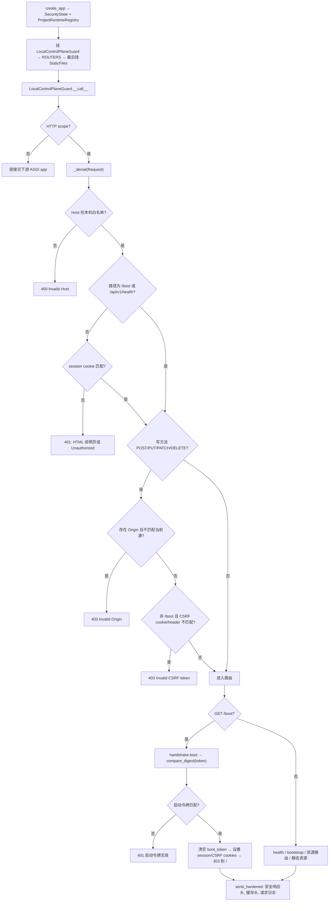

`/health` 不要求激活项目; `/bootstrap` 需要有效会话 cookie, 返回版本, 激活项目及 CSRF.
资源路由经 `active_runtime()` 取当前项目, 需要空闲时再经 `idle_runtime()` 拦住在途 turn.
ASGI 中间件不缓冲 SSE 响应体. 静态资源挂载必须在 API router 后, 否则会截获 API 路径.

### 2.3 项目查找, 信任与激活

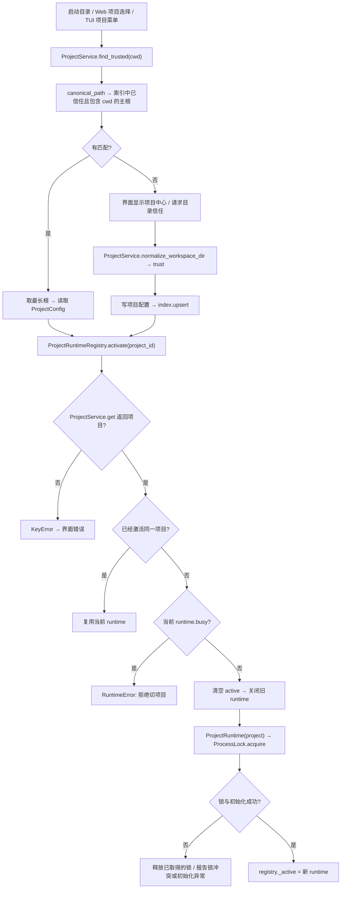

额外工作区根不参与项目身份匹配; 同一 cwd 匹配多个主根时选最深项目. 切项目先关闭旧 runtime,
再建立新 runtime; 新项目初始化失败时不会自动恢复已经关闭的旧 runtime.

### 2.4 组合根装配, 权限上下文与沙箱探测

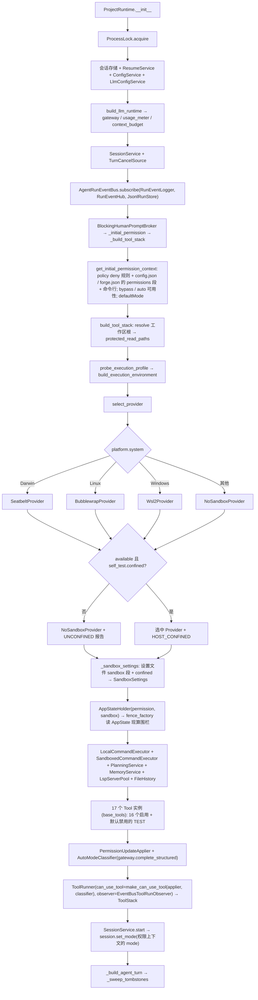

这里的沙箱降级是**启动探测结论**: `SandboxSettings.active = enabled and confined`, 围栏
没立起来时 `should_use_sandbox` 一律为假, 沙箱内自动放行不生效, `Bash` 走本地执行器.
之后不会拿到有沙箱的裁决再临时换成无沙箱执行.

权限上下文只装一次 (`_initial_permission`): 三张规则表按来源分组 (内置 policy, 用户,
项目, 命令行, 会话), 额外工作目录来自设置文件的 `additionalDirectories` 与项目的其他根
(`PROJECT_SETTINGS` 来源), `is_bypass_permissions_mode_available` 与
`is_auto_mode_available` 是启动期事实 (§12.5). `reload_llm` 重建工具栈时把当前权限上下文
原样带过去, 会话里已经加的规则与目录不丢.

`_build_agent_turn()` 里的 `new_loop()` 每轮先调 `builtin_rules(context=窗口管理器)`
建一份 `RuleTable` (五个时机各一列方法), 再交给 `BuiltinAgentLoop`. 窗口管理器不直接传给
循环, 传给对应的规则.

`AgentTurnService` 收的 `context_budget` / `memory` / `planning` / `tools` 是读
`self.llm` / `self.tools` 当前字段的闭包 (ADR-0051 决策 5). `reload_llm` 重建
`llm` 与 `tools` 后一起换上, 再重建窗口管理器; 会话服务不重建也不重配置, 下一轮的
闭包自然指向新的.

### 2.5 TUI 输入与退出

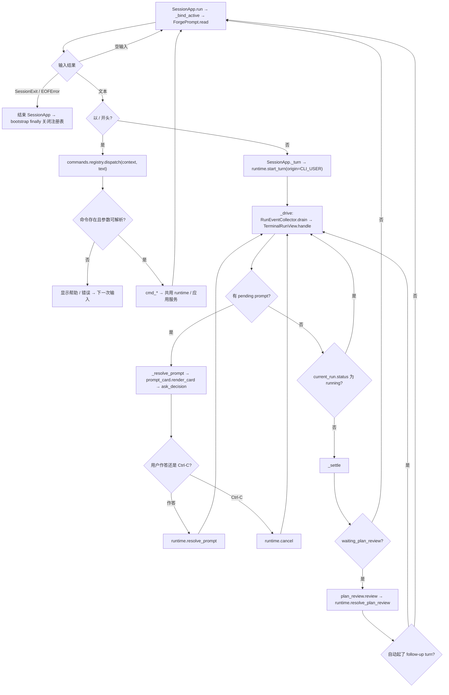

普通文本即使以 `#` 开头也走 `_turn()`, 当前不存在独立人工 Shell 分支.
运行期第一次 Ctrl-C 请求取消; 第二次 Ctrl-C 只结束 `_drive()` 的等待, 源码明确提醒已发出的
命令可能还在运行. 输入框退出, 取消菜单, 取消当前 turn 是不同作用域. 输入框里的 Tab /
Shift-Tab 沿 `runtime.presets` 切模式 (`SessionApp._step_mode`), 两端截断不回绕.

Web 关闭路径是 `web.server` 设置 stopping → SSE 发停止帧 / 退出 → FastAPI lifespan
调用 `registry.close()` → `ProjectRuntime.close()` 调用 cancel, prompts.close, events.close,
关掉语言服务器子进程 (`ToolStack.close`), 最多等待 Agent 线程 2 秒并释放项目锁. 这不是
"无限等待所有子进程退出"的保证.

## 3. 主流程: 一条用户消息到一轮最终响应

源码入口: `web/src/features/conversation/useConversation.ts`, `web/routers/turns.py`,
`runtime/project_runtime.py`, `agent/turn_service.py`.

### 3.1 Web 发送, 线程启动和前端对账

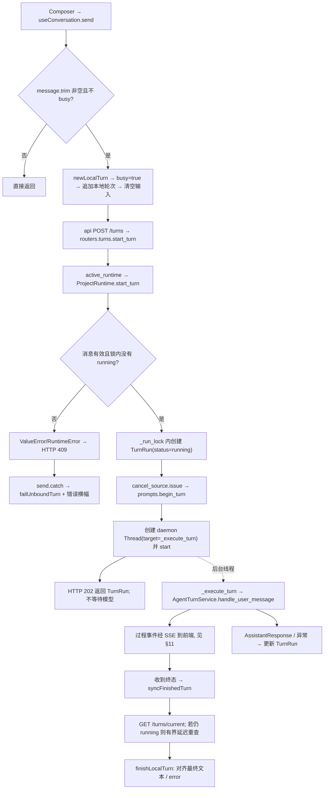

HTTP 202 只说明后台任务已启动; SSE 的 turn 终态可能先于 `_execute_turn()` 最后一次赋值,
所以 `syncFinishedTurn()` 要查询权威的 `current_run()`, 不能用 202 当完成证明.

### 3.2 AgentTurnService: 外层只管一轮的生命周期

ADR-0051 之后这里是**外层**: 记, 跑, 记. 它把两个函数交给循环 —— `execute` (执行**一批**
工具, 经执行链) 和 `assemble` (组一次上下文, 读计划, 记忆, 目录) —— 然后等循环跑完.
每一轮工具执行几次, 上下文什么时候组, 都是循环 (§4) 的事.

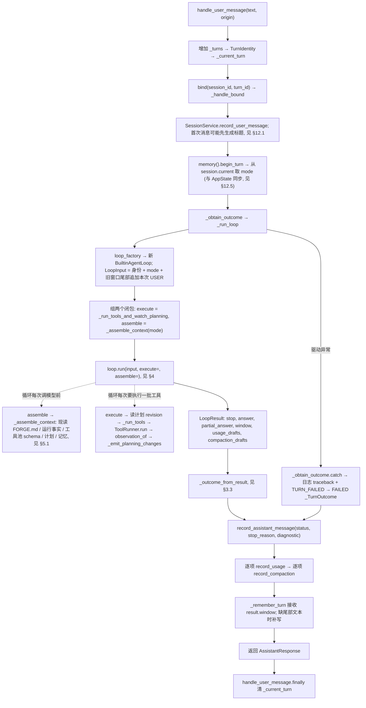

没有 `for` 也没有步数上限了: `_run_loop` 就是一次 `loop.run`. 一轮的上限是循环里
`ModelBudgetRule` 那个模型调用次数.

`context_budget` / `memory` / `planning` / `tools` 四个构造参数都是**函数** (组合根传的是
读 `self.llm` / `self.tools` 当前字段的闭包, §2.4). 用到时才调: `self._memory()`,
`self._tools()` (返回 `ToolRunner`). `reload_llm` 换了组合根的字段, 这里下一次调用自然
指向新的, 没有 `reconfigure`.

`_run_tools_and_watch_planning()` 比较 `(id, revision)`, 不是比较工具名. 新建一份计划与
修改原计划都可以触发变化; 计划 / 待办事件里保存摘要和引用, 正文由 PlanningService 读取.
`_run_tools()` 是循环触达真实世界的**唯一**路径: 把一批 `ToolCall` 交给
`ToolRunner.run(calls, session_id, turn_id, messages=窗口)`, 拿回同样多的 `ToolUseOutcome`,
经 `tools/runner.py::observation_of` 翻成 `LoopObservation` (§6.1). 没装工具栈时每个调用
回一条 `loop.tools_not_wired` 的错误结果.

`_obtain_outcome()` 隔离的是 `_run_loop()` 内异常. 其前后的会话落盘失败不受这层 catch
保护, 会继续到 `_execute_turn()` 的后台边界. 因此"任何故障都能完整记录一对消息"不是
当前代码可保证的不变量, 磁盘写失败尤其如此.

### 3.3 终态映射与异常边界

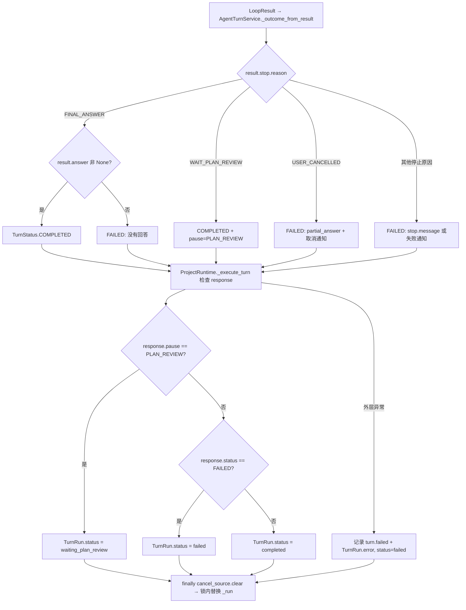

`LoopStopReason.classification` 是语义分类, `TurnStatus` 是消息持久化终态, `TurnRun.status`
是控制面的后台状态, 三者不能逐字互换. 例如 `CONTEXT_COMPACTION_REQUIRED` 分类为
`RESUMABLE_PAUSE`, 但目前 `_outcome_from_result()` 仍把它映射为 FAILED; 只有计划评审得到
专门的 `pause=PLAN_REVIEW`.

## 4. 主流程: BuiltinAgentLoop, 一次查询跑到底

源码入口: `agent/loop/builtin_loop.py` (控制流), `rule_table.py` (规则表怎么跑),
`rules/__init__.py` (十条规则的顺序与理由), `rules/*.py` (每条判断一个文件), `verdicts.py`
(规则给循环的处置), `rule.py` (规则能看到什么), `ledger.py` (本轮账本),
`model_invoker.py`, `transcript.py`, `core/agent/actions.py` (`LoopResult`, `ToolExecutor`,
`ContextAssembly`, `LoopObservation`), `core/agent/phase.py`, `core/agent/stop.py`.

ADR-0051 之后循环是**内层**: 一次查询的完整生命周期 —— 想, 做, 记, 直到模型不再要工具.
它收外层交进来的两个函数: `execute(calls) -> tuple[LoopObservation, ...]` 执行一批工具,
`assemble() -> AssembledContext` 组一次上下文. 循环拿不到工具池, 运行时和各个服务, 只会调
这两个函数 (ADR-0051 决策 1, 2). "下一步做什么"的判断全在 `rules/` 里 (ADR-0049), 循环
只剩控制流. 读循环跟着 `run → _think_and_act → _run_batch → _execute → _stop` 走;
读某条判断去它自己的文件.

### 4.1 run → 每次现组材料 → 规则表 → 模型请求 → 回答或一批工具

```mermaid
flowchart TD
    A["BuiltinAgentLoop.run(LoopInput, execute=, assemble=)"] --> B{"_phase == NOT_STARTED?"}
    B -->|否| C["RuntimeError: 每 turn 一个实例"]
    B -->|是| D["_phase=RUNNING; 设置身份, mode, 窗口=initial_window; events.start_turn"]
    D --> E["_think_and_act: while True"]
    E --> F["_context = assemble(): 这次的 system prompt, 工具 schema, 状态帧, 预算"]
    F --> G["RuleTable.before_model(_view, _apply_rewrite)"]
    G --> G2["model_budget: 到上限则 LoopStop(BUDGET_EXHAUSTED)"]
    G2 --> G3["context_fit: WindowManager.fit, 见 §5.2; 淘汰过则 Rewrite"]
    G3 -->|任一条 LoopStop| H["_stop → return"]
    G3 -->|都 Continue 或 Rewrite| I["_call_model: _build_request(_context.system_prompt / 有效工具 / 窗口+状态帧)"]
    I --> J["AgentModelInvoker.invoke, 见 §9"]
    J -->|LoopStop (取消 / 中断)| H
    J -->|ModelGatewayError| K["RuleTable.on_model_error, 见 §4.4"]
    K -->|Reask / Rewrite| L["_apply_retry → continue (回到 F 重新 assemble)"]
    L --> E
    K -->|LoopStop| H
    J -->|ModelOutcome| M["RuleTable.after_model(outcome, _view())"]
    M --> M2["empty_response: 空回复 → LoopStop(MODEL_ERROR_BLOCKING)"]
    M2 --> M3["malformed_output: 参数混进协议标记 → Reask, 见 §4.4"]
    M3 --> M4["tools_closed: 目录已收还要工具 → 无文本 LoopStop(POLICY_DENIED) / 有文本 Replace"]
    M4 -->|Reask| L
    M4 -->|LoopStop| H
    M4 -->|Replace| N["outcome = 剥掉 tool_calls 的文本"]
    M4 -->|Continue| O["_remember_assistant"]
    N --> O
    O --> P{"有 tool_calls?"}
    P -->|否| Q["_answer = text → _stop(FINAL_ANSWER) → return"]
    P -->|是| R["_run_batch(tool_calls, execute), 见 §4.2"]
    R -->|返回 LoopStop| H
    R -->|返回 None: 这批做完或目录收了| E
    H --> S["run 收成 LoopResult: stop, answer, partial_answer, window, 两种草稿"]
```

**每圈开头都 `assemble()` 一次** (ADR-0051 决策 2). 一轮里输入没变, 组出来的是同样的字节,
供应商前缀缓存照样命中; 模型这轮改了待办, 写了记忆, 改了 FORGE.md, 下一圈就看到.
`_tools` 是一个属性: 目录一旦被规则收掉 (`_tools_closed`), 后面每次 `assemble` 带回来的
目录都不再发给模型.

`_think_and_act` 不调用自己: 四条"追加点东西再来一次"的路 (格式重试, 溢出强压, 工作区
变更, 收工具) 都是 `continue`, 回到顶上重新 `assemble`, 不撞递归上限.

`outcome.text` 与 `outcome.tool_calls` 可以同时存在. 带工具的 assistant 消息必须先写入窗口,
再追加对应 tool result; 格式损坏的调用在 `after_model` 阶段就被 `Reask` 拒掉, 永远不会走到
`_remember_assistant`, 否则会留下配不齐的协议记录.

### 4.2 同一批多个工具: 先逐个过 before_dispatch, 再整批交出去

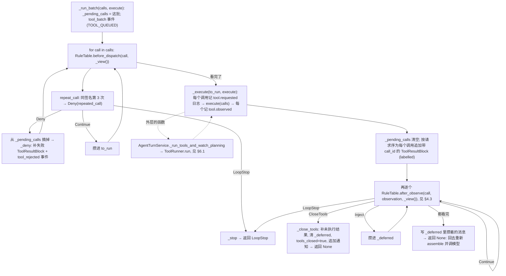

批量意图事件表示"模型请求了哪些工具", 不是执行事实. 分批与并发在执行链里 (ADR-0054
决策 4): 循环只看到"一批进, 一批出", 但审批仍一次次发生 (在执行链的第 6 步里). 结果
**先全部回填再看规则**: 协议要求每个 tool_call 都有配对的结果, 规则的处置 (停, 收工具)
不能让已经执行了的调用没有结果. 重复调用的判定用 `repeat_call.signature_of()`: 工具名加
规范化参数; 改变参数不会命中同一签名, 所以还需要 `barren_streak` 那条"连续无新信息"的
提醒. `Inject` 必须等整批回填完再写, 这条保证由循环的 `_deferred` 执行, 规则说了不算 ——
插在两条 tool result 中间供应商会拒.

`_close_tools` 不再回调循环: 它只收目录, 补结果, 追加通知, 然后 `_run_batch` 返回 `None`,
`_think_and_act` 回到顶上再想.

### 4.3 拿到结果之后: 计划评审, 人拒绝, 策略拒绝与无进展

`after_observe` 那一列三个方法按写的顺序跑, 第一个给出非 `Continue` 处置的就算数:

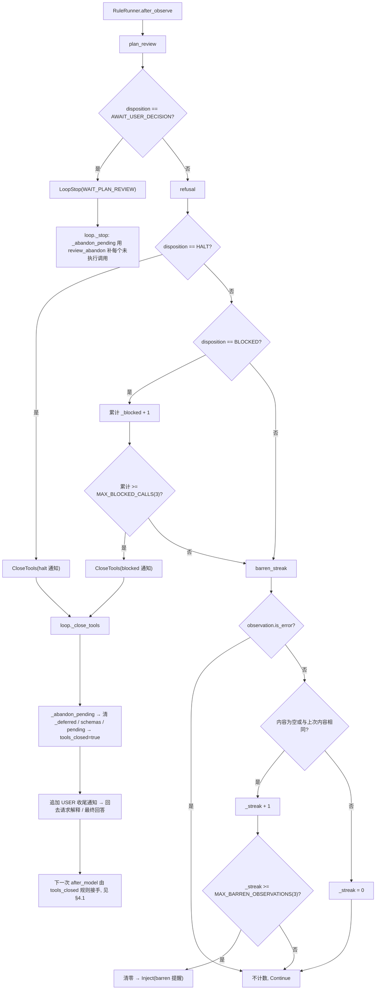

disposition 由 `tools/runner.py::observation_of` 从 `ToolUseOutcome` 定: `await_user_decision`
→ AWAIT_USER_DECISION; `user_rejected` (人在卡片上拒绝, 或无人能答) → HALT; `status ==
"denied"` (deny 规则, dont_ask, auto 模式的分类器) → BLOCKED; 没执行就出错的
(找不到工具, 入参不合 schema) 是 ERROR 来源的普通错误, 不自动等于 HALT. `refusal._blocked`
是累计值, 插入一次成功读取不能重置它; `barren_streak` 只观察成功结果. `plan_review` 声明了
必须排在 `refusal` 之前: 两者都不再派工具, 但一个是"轮到人说话", 一个是"你被罚闭嘴".

### 4.4 模型错误与格式纠错

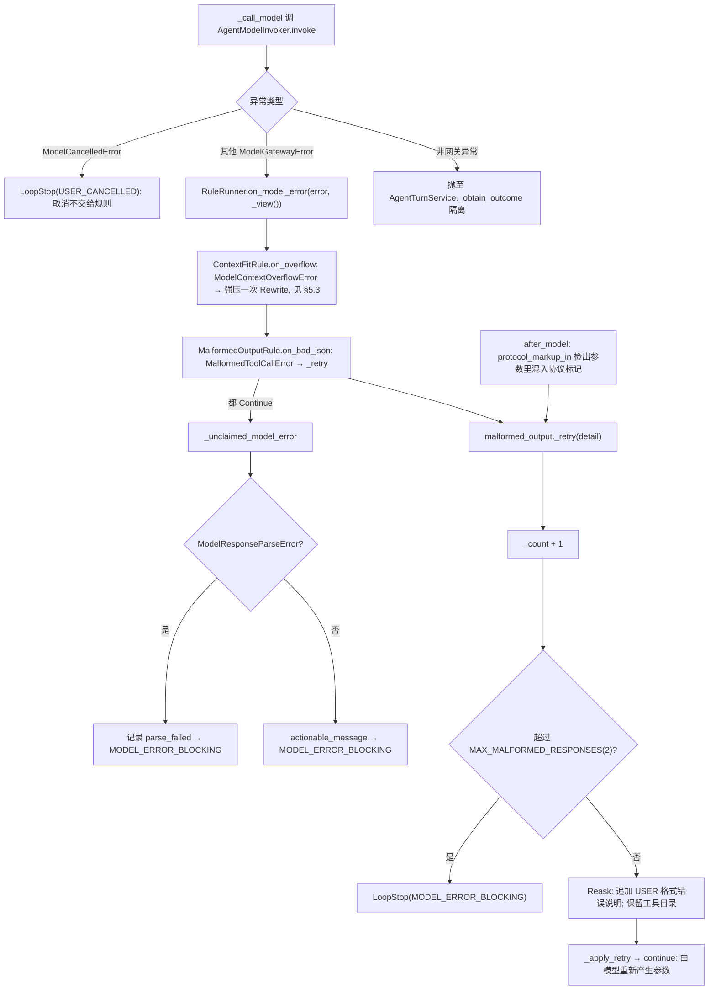

`MalformedOutputRule` 的 `after_model` (标记污染) 与 `on_bad_json` (半截 JSON) 两条路
共用一个计数器; 纠错不猜参数, 不修补模型产生的半截 JSON. 网关传输重试见 §9.3, 那条路
通常重发同一请求; 这里是改变上下文, 让模型重新回答, 二者不能合并计数.

### 4.5 规则表: 按时机列方法, 处置与隔离

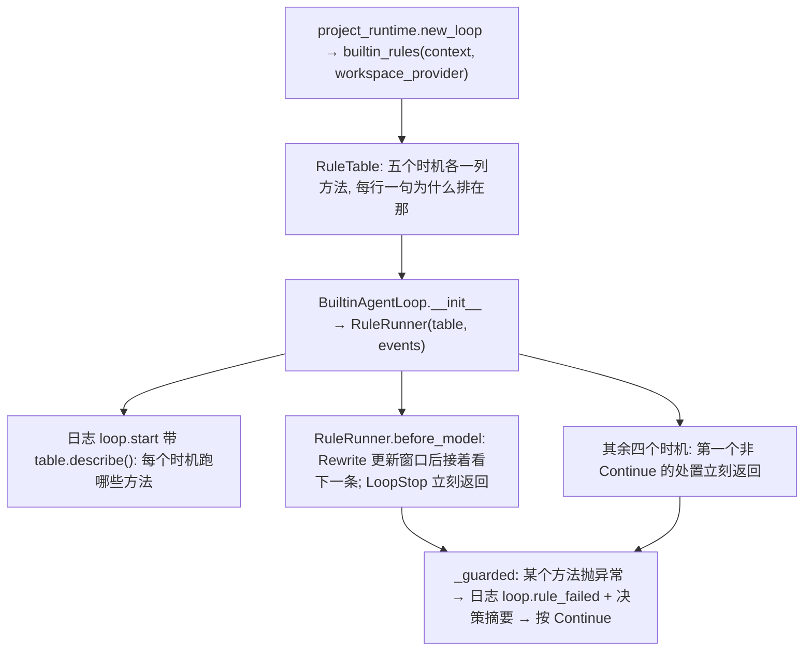

一条规则就是一个方法: 收 `LoopView` 加这个时机的输入, 返回这个时机允许的处置. 方法叫
什么, 属于哪个类都随意 (`fit.on_overflow` 比 `fit.on_model_error` 更说事); 它在哪个时机
跑, 由 `rules/__init__.py` 那张表决定, 不由方法名决定. 同一个对象的方法出现在几列, 它就
参与几个时机, 状态自然共享 (`context_fit` 与 `malformed_output` 各两列). 读那一个文件
就知道每个时机跑什么, 什么顺序, 为什么.

| 时机 | 一列的元素类型 | 允许的处置 | 今天那一列 (按写的顺序) |
|---|---|---|---|
| 调模型之前 | `BeforeModelStep` | `Continue` / `Rewrite` / `LoopStop` | `ModelBudgetRule.before_model`, `ContextFitRule.before_model` |
| 模型调用出错 | `ModelErrorStep` | `Continue` (不归我管) / `Reask` / `Rewrite` / `LoopStop` | `ContextFitRule.on_overflow`, `MalformedOutputRule.on_bad_json` |
| 模型回来之后 | `AfterModelStep` | `Continue` / `Replace` / `Reask` / `LoopStop` | `EmptyResponseRule.after_model`, `MalformedOutputRule.after_model`, `ToolsClosedRule.after_model` |
| 派发一个工具之前 | `BeforeDispatchStep` | `Continue` / `Deny` / `LoopStop` | `RepeatCallRule.before_dispatch` |
| 拿到工具结果之后 | `AfterObserveStep` | `Continue` / `Inject` / `CloseTools` / `LoopStop` | `PlanReviewRule.after_observe`, `RefusalRule.after_observe`, `BarrenStreakRule.after_observe` |

每一列的元素类型是 `Callable[[...], 该时机的处置联合]` (定义在 `rule.py`): 把
`repeat.before_dispatch` 塞进 `after_model=`, 或让一个方法返回这个时机不允许的处置, mypy 在
装配那一行报错.

| 处置 | 循环怎么执行 |
|---|---|
| `Rewrite(window)` | 换窗口; 调模型前继续看下一条, 出错后回到调模型前重来 |
| `Reask(messages)` | 这次输出作废, 追加消息, 重新调模型; 不写 assistant 消息 |
| `Replace(outcome)` | 用改写后的输出继续 |
| `Deny(notice, code)` | 补一条 `is_error` 的工具结果 + `tool_rejected` 事件, 这个调用不进执行链 |
| `Inject(messages)` | 攒进 `_deferred`, 整批工具结果回填完才追加 |
| `CloseTools(notice)` | `_close_tools`: 补未执行结果, 清目录, 追加通知, 回去调模型 |
| `LoopStop` | `_stop`: 有排队调用则先补"未执行"结果, 再发 turn 终态 |

顺序的四条硬理由 (工作区通知与预算都在压缩之前, 格式坏掉在目录已收之前, 计划评审在收
工具之前) 写在表旁边的注释里; 没有运行期的顺序校验, 也没有数字优先级. 规则能看到的只有
`LoopView` 这份只读快照 (窗口, 目录, 预算, 计数, 排队数量), 能写的只有 `TurnLedger`: 用量
草稿, 压缩记录, 以及把"压缩发生了", "工作区变了"这两件它自己看见的事报成运行事件. 规则
拿不到 `_window`, `_pending_calls` 和事件发布器的其他方法, 也 import 不到工具系统与
安全层 —— 执行链与权限裁决不是规则 (ADR-0049 决策 6).

加一条判断: 写一个方法, 返回它那个时机允许的处置; 在 `rules/__init__.py` 对应时机那一列
加一行, 旁边写一句为什么排在那.

## 5. 主流程: 上下文组装, 压缩与文件变化

源码入口: `prompt/prompts.py`, `prompt/sections.py`, `conversation/assembler.py`,
`conversation/notices.py`, `window_manager.py`, `summarize.py`, `core/agent/state.py`,
`core/context/window.py`, `core/tool/file_state.py`, `core/tool/file_text.py`.

### 5.1 上下文: 四个位置, 变更源决定位置 (ADR-0056)

| 位置 | 内容 | 实际来源 | 读取时机 |
|---|---|---|---|
| `tools` | 工具 schema | `ToolRunner.tool_schemas()`: 按当前权限上下文 `assemble_tool_pool` → `tool.to_model_schema`, 结果按 (池成员, 沙箱) 缓存 | 会话内字节锁定; 池变了由通知告诉模型增减 |
| `system_prompt` 前半 | 静态段: intro, system, doing_tasks, actions, tone_and_style, output_efficiency | `prompts.get_system_prompt` 里的六个纯函数 | 只随包版本变 |
| `system_prompt` 后半 | 会话段: using_your_tools (随池), env_info, FORGE.md 快照, 记忆快照, git 快照 | 同上, 经 `SectionCache` 按名缓存 | 只在刷新点重算: 会话开始, 压缩后, 恢复后, `/reload`, 用户改了 FORGE.md 的下一回合 |
| `messages` | 窗口: 用户, 助手, tool call, tool result, **通知** | `Window.messages`; 通知由 `NoticeAssembler.build` 按窗口推增量, 循环在每次调模型前追加 | 只追加; 撞高水位整段淘汰 |

没有状态帧. 模式说明, 计划, 待办, 记忆变化, 日期变化, 工具增减, 子目录 FORGE.md 全部是
`<system-reminder>` 包着的 meta user 消息 (`ChatMessage.meta=True`, `notice_kind`,
`notice_revision`), 落进事件日志 (`harness_notice`), `/resume` 时按原位置回放.

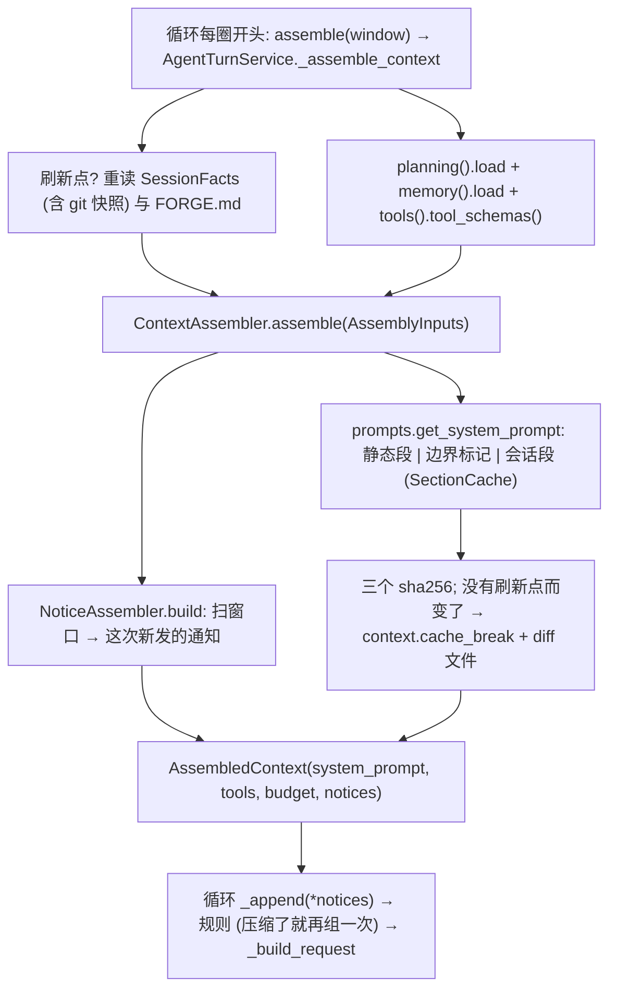

通知的增量与节流全部从窗口推出来 (`conversation/notices.py`): 同类型的上一条在哪, 它之后
有几个用户回合 (模式提醒每 5 个, 每第 5 条完整版), 几次模型调用 (待办 10 次没动就提醒),
调过哪些工具 (模型自己 `plan_write` / `TodoWrite` / `memory_write` 改的不再发). 压缩淘汰掉
旧通知, 计数自然归零, 重注入 (模式, 计划, 待办, 最近读过的文件) 也就自然发生. 重注入时
`read_file_state` 先清空, 只把重注入的那几个放回去 (§5.4); 读过的文件被外部改了的通知
(`file_changed`) 也在这里产出, 见 §5.4.

模型可读的全部 Forge 文字都在 `prompt/prompts.py` 一个文件里 (工具描述除外, 它们在各工具的
`prompt.py`), 包括压缩指令 `COMPACT_PROMPT`, 会话标题 `TITLE_PROMPT` 与 auto 模式分类器的
`auto_mode_classifier_prompt` (§6.6). 没有模板, 没有版本常量, 没有 token 上限: 改正文就是
改代码.

### 5.2 窗口高水位, 合法切点和摘要

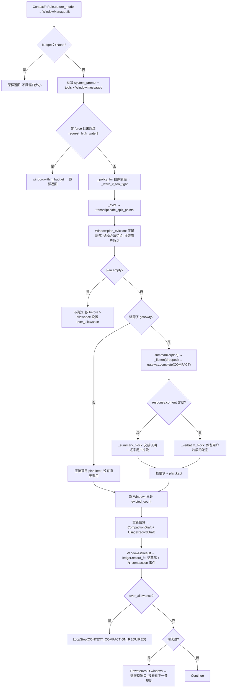

合法切点不能把 assistant tool_calls 与尚未补齐的结果拆开. 这里是一次批量淘汰,
不是每条消息都"滑动删除最旧一条". `_warn_if_too_tight()` 捕获水位校验错误并记录日志,
不直接抛错终止 turn.

需要精确区分三种失败: 摘要返回空文本有 `_verbatim_block()` 兜底; 摘要网关抛异常不会
被 `summarize()` 吞掉, 会沿调用栈上抛; 未装配 gateway 时只保留 `plan.kept`, 不能宣称
该分支也生成了完整的用户原话交接块. 正常组合根装配了 gateway.

### 5.3 供应商报告超窗: 额外一次强制压缩

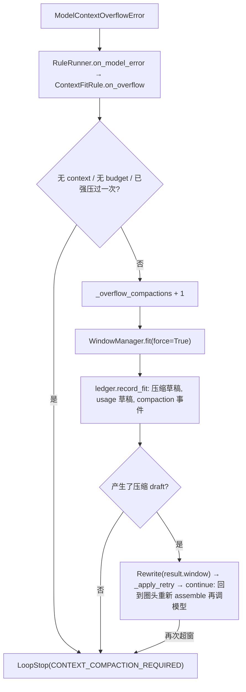

强制压缩复用同一套切点逻辑, 避免降级路径破坏消息配对. 两道防线在同一个文件
`rules/context_fit.py` 里, 共用 `_overflow_compactions` 计数. `WindowManager.fit()` 的估算输入
不显式加入末尾状态帧; 网关 `_pre_call_checks()` 看到的是完整请求, 因此两处预算结果
仍可能不同, 供应商自己的分词也可能不同.

### 5.4 文件变化: 只看读过的文件 (ADR-0056 决策 14)

没有工作区监控, 不扫全树. 每次调模型前 `NoticeAssembler.build` 顺手巡一遍
`read_file_state` (≤100 条, 只看完整读过的), 与 Claude Code 的 `getChangedFiles` 同一条路:

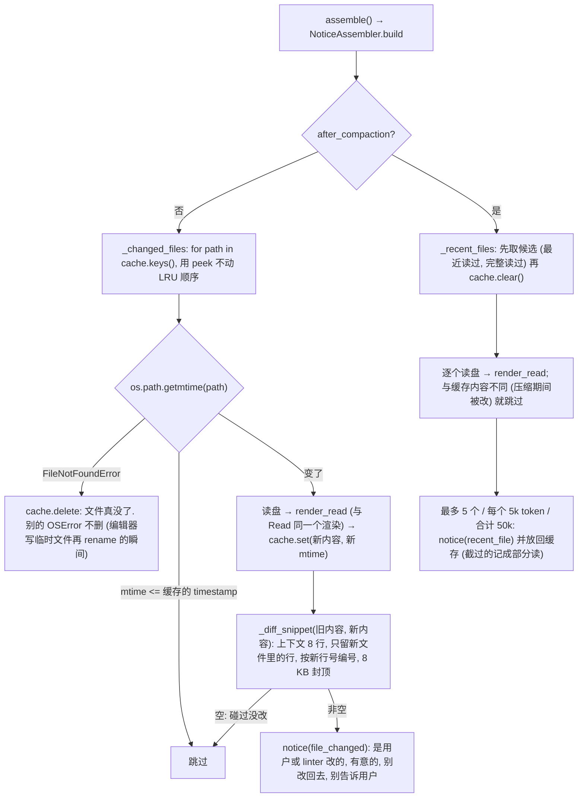

两处都改缓存, 目的是同一个不变量: **缓存说"读过"的文件, 模型上下文里一定有它现在的
内容.** 变化通知发出去, 模型看到了 diff, 缓存换成新内容, 接着 Edit 不必再读; 压缩淘汰了
工具结果, 模型看不见了, 缓存清空, 只有重注入的几个还算"读过". 没读过的文件变没变不通知
—— Edit 只能改读过的文件, 模型要用时 Glob / Read 自然看到. 变化通知有自己的 8 KB 上限,
不占通知批次的 20 KB, 否则一次格式化改了几个文件就把别的通知挤掉, 而缓存已经刷新, 模型
就永远不知道那次变化.

这条通知只提供上下文, 不能替代执行链里的裁决与 `FileStateCache` 的先读再改 (§8.2): 权限
询问期间文件又被改了, 由 `Edit.call` / `Write.call` 里的第二次检查兜底.

## 6. 主流程: 工具执行链与权限裁决

先读协议与类型: `core/tool/tool.py` (`Tool`, `ToolUseContext`, `ToolResult`,
`CanUseToolFn`) → `core/permissions.py` (`PermissionMode`, `PermissionRule`,
`PermissionResult`, `PermissionDecisionReason`, `ToolPermissionContext`) →
`core/app_state.py`. 再读 `tools/runner.py`, `tools/orchestration.py`, `tools/execution.py`,
`security/permissions.py`, `security/interactive.py`. 每一段都对应 Claude Code 的一个
文件, 模块开头的注释写着对应关系.

| 对象 | 表达什么 | 不表达什么 |
|---|---|---|
| `Tool` (ABC) | 一个工具对协议问题的回答: `prompt`, `input_schema`, `validate_input`, `check_permissions`, `is_read_only`, `is_concurrency_safe`, `call`, `map_tool_result_to_block`, `to_auto_classifier_input`; 缺省全部保守 | 一次调用已获准 |
| `ToolUseContext` | 一次 turn 内共用的总线: 工具池, 取消令牌, `FileStateCache`, 当前窗口, `get_app_state` / `set_app_state`, cwd, 环境, 提示通道, 观察者, 文件历史钩子, 落盘目录 | 权限本身 (权限在 `AppState.tool_permission_context` 里) |
| `PermissionResult` | `allow` / `deny` / `ask` / `passthrough` (只在工具与框架之间出现), 带 `message`, `decision_reason`, `suggestions`, `updated_input` | 执行结果 |
| `ToolUseOutcome` | 一次 tool_use 的全部产出: `ToolResultBlock`, `status` (ok / error / denied / rejected / cancelled), `executed`, `user_rejected`, `await_user_decision` | 界面展示的全部过程事件 (那些经 `ToolRunObserver` 发) |
| `LoopObservation` | 给循环的统一结果与处置 (`observation_of` 翻出来的) | 执行细节 |

### 6.1 ToolRunner → 分批 → 七步执行链

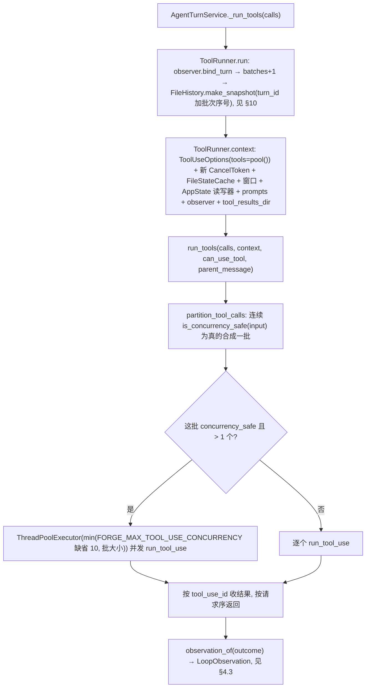

工具池 `ToolRunner.pool()` 每次按**当前**权限上下文现算 (`tools/pool.py::assemble_tool_pool`):
整工具 deny 规则命中的不进池, `is_enabled()` 为假的不进池, 按名字排序去重. 查找认
`aliases` 与曾用名表 (`core/tool/names.py::LEGACY_TOOL_NAMES`), 所以旧记录里的 `shell_run`
能找到 `Bash`. 只有 `Read` / `Glob` / `Grep` / `LSP` / `AskUserQuestion` / 只读的 `Bash`
声明并发安全; `Edit` / `Write` / 写命令各自一批串行.

`run_tool_use` (`tools/execution.py`) 七步, 顺序固定, 每一步失败都是一条 `is_error` 的
tool_result 回给模型 (`<tool_use_error>...</tool_use_error>`):

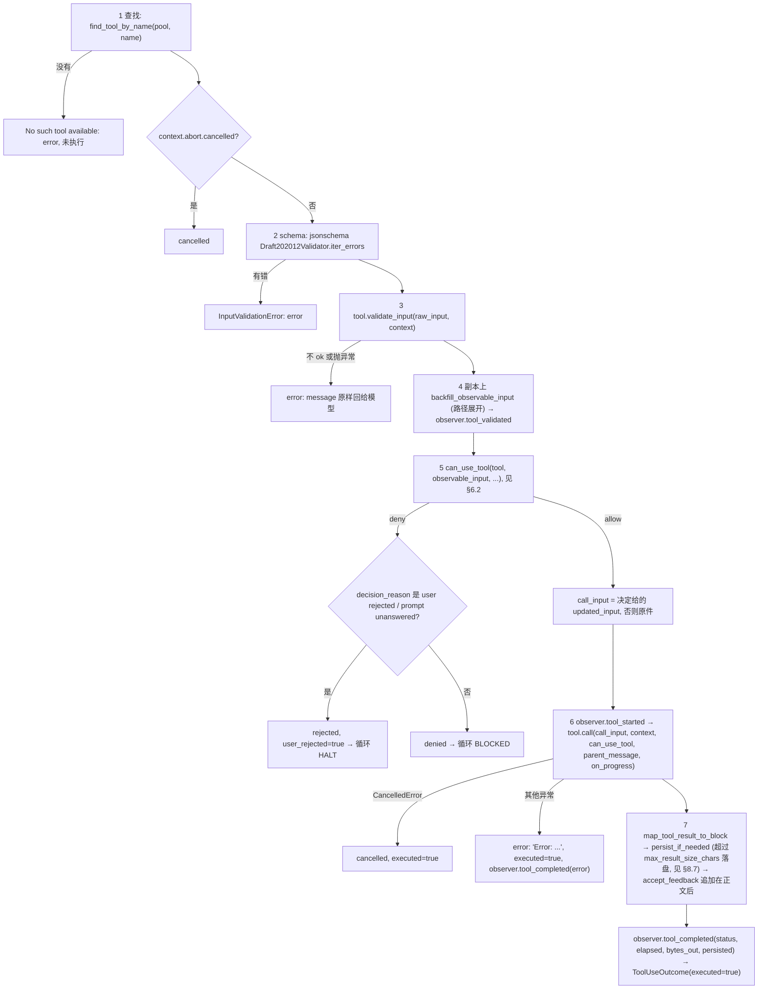

没有用户配置的 hook: Claude Code 在权限前后各有一个 (PreToolUse / PostToolUse), 本仓库
2026-09-18 撤掉了 (ADR-0054 决策 6 已作废), 需要时再加. 一次 tool_use 只
产生一条 tool_result; 中间事实经 `context.observer` (`agent/tool_observer.py::EventBusToolRunObserver`)
发成 `TOOL_PREPARED` / `POLICY_RESOLVED` / `APPROVAL_*` / `TOOL_STARTED` / `TOOL_COMPLETED` /
`TOOL_CANCELLED` 事件 (§11.1).

### 6.2 裁决顺序: has_permissions_to_use_tool, 与 permissions.ts 逐行对应

`can_use_tool` 是 `security/interactive.py::make_can_use_tool(applier, classifier)` 组出来的
函数: 先 `has_permissions_to_use_tool`, 发 `permission_decided`, 只有 ask 才摆卡片 (§6.5).

```mermaid
flowchart TD
    A["has_permissions_to_use_tool(tool, input, context, classifier)"] --> B["_inner"]
    B --> B1{"1a 整工具 deny 规则?"}
    B1 -->|是| D["deny, rule_reason"]
    B1 -->|否| B2{"1b 整工具 ask 规则, 且不是'会进围栏的 Bash 且沙箱自动放行开着'?"}
    B2 -->|是| ASK1["ask, rule_reason"]
    B2 -->|否| B3["1c tool.check_permissions(input, context); 抛异常按 passthrough"]
    B3 --> B4{"1d 工具说 deny?"}
    B4 -->|是| D
    B4 -->|否| B5{"1e requires_user_interaction 且 ask? / 1f 内容级 ask 规则? / 1g 安全检查?"}
    B5 -->|是| ASK2["ask 原样返回 (bypass 也问)"]
    B5 -->|否| B6{"2a mode 是 bypass_permissions, 或 plan 且 bypass 可用?"}
    B6 -->|是| AL1["allow, mode_reason, 入参取工具给的 updated_input"]
    B6 -->|否| B7{"2b 整工具 allow 规则?"}
    B7 -->|是| AL2["allow, rule_reason"]
    B7 -->|否| B8{"3 工具说 passthrough?"}
    B8 -->|是| ASK3["ask: create_permission_request_message + 工具给的 suggestions"]
    B8 -->|否| ASK4["工具给的 ask / allow 原样"]
    D --> R["返回"]
    AL1 --> R2{"外层: allow 且 auto 生效?"}
    AL2 --> R2
    R2 -->|是| R3["record_success: 连续被拦计数清零"]
    R2 --> R
    ASK1 --> O{"外层: mode 是 dont_ask?"}
    ASK2 --> O
    ASK3 --> O
    ASK4 --> O
    O -->|是| O1["deny, DONT_ASK_REJECT_MESSAGE"]
    O -->|否| O2{"auto 生效 (mode 是 auto, 或 plan 且 pre_plan_mode 是 auto) 且接了分类器?"}
    O2 -->|是| O3["_auto_mode_decision, 见 §6.6"]
    O2 -->|否| O4{"should_avoid_permission_prompts (无界面)?"}
    O4 -->|是| O5["deny: prompts are not available"]
    O4 -->|否| O6["ask → 摆卡片, 见 §6.5"]
```

规则表按来源求值 (`_SOURCES`: policy → user → project → cli → session), 每条规则
`Bash(git commit:*)` 由 `security/permission_rule_parser.py` 解析成 `(工具名, 内容)`,
没有括号就是整工具规则. 内置的 policy deny 规则在 `security/policy_rules.py` (`Read` / `Edit`
`~/.ssh/**`, `~/.aws/**`, `~/.gnupg/**`, `//etc/shadow` 等, 以及 `Edit(~/.forge/**)`),
任何模式 (含 bypass) 都拦.

### 6.3 Bash 自己的裁决

`tools/builtin/Bash/bash_permissions.py::bash_tool_has_permission` (`BashTool.check_permissions`
调它), 解析器是 `security/shell/parser.py` (方言来自真实的 `shell_launch`):

```mermaid
flowchart TD
    A["parse_for_permissions(command, shell_kind, cwd) → CommandPlan"] --> B{"0 too_complex_reason: 命令替换 / 进程替换 / 控制流 / 解析器不认识?"}
    B -->|是| B1["_check_early_exit_deny: 精确 / 前缀 / 通配 deny 命中就 deny"]
    B1 -->|没命中| B2["ask, 理由是 too-complex 的原因; 前缀 allow 规则在这里不算数"]
    B -->|否| C{"1 sandbox.auto_allow_bash_if_sandboxed 且 should_use_sandbox?"}
    C -->|是| C1["_check_sandbox_auto_allow: 先查 deny / ask 规则, 没命中 → allow, sandbox_override_reason"]
    C -->|否| D["2 整条命令精确匹配规则; deny / ask 立刻返回"]
    C1 -->|命中 deny/ask 规则| D
    D --> E["3 逐子命令 bash_tool_check_permission 八步"]
    E --> E1["精确 deny/ask → 前缀/通配 deny/ask → check_path_constraints (cd / 重定向到工作目录外, 目标含 $VAR, rm -rf 到危险路径: ask) → 精确 allow → 前缀/通配 allow → sed 约束 → check_permission_mode (accept_edits 下 mkdir/touch/rm/rmdir/mv/cp/sed 在工作目录内 allow) → unit_is_read_only (只读命令表) allow → passthrough + 精确命令建议"]
    E1 --> F{"合并"}
    F -->|任一 deny| G["deny, subcommand_results_reason"]
    F -->|全部 allow| H["allow"]
    F -->|整条精确 allow| H
    F -->|否则| I["ask: 单个子命令用它自己的措辞, 多个用'contains multiple operations'; suggestions 是没被 allow 的子命令合成一条前缀建议 (Bash(git commit:*))"]
```

只读命令表在 `read_only_validation.py` (`ls`, `cat`, `git status` / `log` / `diff`, `grep`,
不带 `-exec` / `-delete` 的 `find` 等, 逐命令带不安全参数表); 含 `cd` 与 `git` 的复合命令,
写 `.git/` 内部路径的都不算只读. `BashTool.is_read_only` 也用它, 所以只读命令在 `default`
与 `plan` 下直接放行, 且与别的只读调用并发. `is_destructive` 由
`destructive_command_warning.py` 回答, 只影响卡片上的提醒.

### 6.4 文件工具的裁决

`security/filesystem.py`, 每个文件工具的 `check_permissions` 调它; 路径先经
`paths_for_permission_check` 同时取原路径与 realpath, 规则用 wcmatch 的 glob (`//abs`,
`~/`, `/` 相对规则来源的根, 相对路径相对 cwd, 目录规则覆盖其内容):

| 读 (`check_read_permission_for_tool`: Read / Glob / Grep / LSP) | 写 (`check_write_permission_for_tool`: Edit / Write) |
|---|---|
| 1 UNC 路径 → ask (安全检查) | 1 edit deny 规则 → deny |
| 2 可疑的 Windows 路径 → ask (安全检查) | 1.5 内部可写路径 (会话目录, tool-results) → allow |
| 3 read deny 规则 → deny | 1.6 `~/.forge/**` 只认 session 来源的 allow 规则 |
| 4 read ask 规则 → ask | 1.7 `check_path_safety_for_auto_edit`: 可疑 Windows 路径; Forge 设置; `.git` / `.vscode` / `.idea` / `.forge` / `.claude` 与 `.bashrc` 一类 shell 配置 → ask (安全检查, bypass 也问; 后两种标 `classifier_approvable`, auto 下交分类器) |
| 5 edit allow 规则视为可读 | 2 edit ask 规则 → ask |
| 6 在工作目录 (cwd 或 `additional_working_directories`) 内 → allow | 3 `accept_edits` 且在工作目录内 → allow |
| 7 内部路径 → allow | 4 edit allow 规则 → allow |
| 8 read allow 规则 → allow | 5 其余 ask; 建议: default / plan 下 `set_mode accept_edits`, 目标在工作目录外再加 `add_directories` |
| 12 其余 ask, 建议 `add_directories` | |

### 6.5 ask 的去向: 卡片, 建议与"始终允许"

```mermaid
flowchart TD
    A["can_use_tool 拿到 ask"] --> B["_prompt: HumanPrompt(kind=APPROVAL, title=user_facing_name, body=message, detail=_detail)"]
    B --> C["choices: yes '允许这一次' + 每条 suggestion 一个 'suggestion_i' + no '拒绝'"]
    C --> D["observer.permission_prompted → context.prompts.ask(prompt), 见 §7.1"]
    D --> E{"answer.resolved?"}
    E -->|否 (取消 / 关闭 / 无人)| F["deny: prompt unanswered → 循环按 HALT"]
    E -->|choice == no| G["deny: REJECT_MESSAGE (与 Claude Code 逐字同) → HALT"]
    E -->|suggestion_i| H["PermissionUpdateApplier.apply(suggestions[i], 权限上下文) → set_app_state"]
    H --> I["allow, updated_input 取决定里的"]
    E -->|yes| I
```

`detail` 里给界面的字段: `tool_name`, `tool_use_id`, `user_facing_name`, `activity`,
`summary`, `input` (可 JSON 化的入参), `message`, `reason` (`decision_reason.describe()`,
分类器退回问人时是它的理由), `blocked_path`, `destructive`, `suggestions` (每条带 `label`,
`rules`, `directories`, `mode`). 终端 `tui/prompt_card.py::_render_approval` 与 Web
`ApprovalCard` 照这份 detail 画, 按钮文字来自 `suggestion_label`, 两边不各写一份.

建议是 `PermissionUpdate`: `Bash` 的前缀建议 (`Bash(git commit:*)`) 与文件工具的
`set_mode accept_edits` / `add_directories` 都落 `project_settings` (写回
`~/.forge/projects/<id>/forge.json` 的 `permissions` 段) 或 `session` (只在内存);
`user_settings` 写 `~/.forge/config.json`. 没有学习规则的哈希绑定: 规则就是一行文字,
下次同前缀的命令在 §6.3 第 5 步直接命中. `/permissions` 与 `GET /api/v1/permissions`
列三张表, `remove` 可以删 session / project / user 来源的, policy 只读 (§12.5).

### 6.6 auto 模式: 把要不要问交给分类器

`security/permissions.py::_auto_mode_decision` (对应 `permissions.ts` 里 `mode === 'auto'`
那一段, ADR-0058 决策 4); 分类器在 `security/auto_mode_classifier.py`:

```mermaid
flowchart TD
    A["ask 且 auto 生效"] --> B{"decision_reason 是安全检查且 classifier_approvable 为假 (可疑 Windows 路径, UNC)?"}
    B -->|是| B1["照问人; 无界面 → deny"]
    B -->|否| C{"tool.requires_user_interaction()?"}
    C -->|是| B1
    C -->|否| D["快路一: _with_mode(context, ACCEPT_EDITS) 再问一次 tool.check_permissions"]
    D -->|allow| D1["allow, mode_reason(auto); record_success"]
    D -->|不 allow| E{"快路二: 工具在 AUTO_MODE_ALLOWLISTED_TOOLS (Read / Grep / Glob / LSP / TodoWrite / AskUserQuestion)?"}
    E -->|是| D1
    E -->|否| F["AutoModeClassifier.classify(messages=窗口, tool, input, tools=池, permission, session, turn, cancel)"]
    F --> F1["action = {tool.name: to_auto_classifier_input(input)}; '' → 直接 allow, 不调模型"]
    F1 --> F2["build_transcript_lines: USER 文本各一行 {'user': ...}, ASSISTANT 的每个 tool_call 一行 {'Bash': ...}; TOOL 消息与 assistant 文本不进"]
    F2 --> F3["系统提示词 render_classifier('auto_mode', allow, soft_deny, environment) ← 设置文件 autoMode 段 (用户级 + 项目级)"]
    F3 --> F4["用户消息: FORGE.md 原文 + transcript 标签包着的 JSONL"]
    F4 --> F5["StructuredModelRequest(origin=PERMISSION_CLASSIFIER, schema {thinking, should_block, reason}, strict) → 注入的 gateway.complete_structured"]
    F5 -->|抛异常 / data 不合形| G["ClassifierVerdict(should_block=true, unavailable=true)"]
    F5 -->|正常| H["ClassifierVerdict(should_block, reason, model, duration_ms)"]
    H -->|不拦| I["allow, classifier_reason('auto-mode', reason); record_success"]
    G --> J["deny: build_classifier_unavailable_message (说清是暂时的); 不计数"]
    H -->|拦| K["record_denial: consecutive+1, total+1"]
    K --> L{"should_fallback_to_prompting: 连续 >= 3 或累计 >= 20?"}
    L -->|是| M["退回原来的 ask, 理由换成分类器的 (累计到 20 清零); 无界面 → deny"]
    L -->|否| N["deny: build_auto_mode_rejection_message(reason) + DENIAL_WORKAROUND_GUIDANCE"]
```

进出 auto 的账在 `security/auto_mode.py` 与 `security/permission_setup.py::transition_permission_mode`:
进 auto 时 `strip_dangerous_permissions_for_auto_mode` 把会绕过分类器的 allow 规则
(整工具 `Bash`, `Bash(*)`, `Bash(python:*)` 一类解释器 / shell / `sudo` 前缀, 清单在
`dangerous_patterns.py`) 从 allow 表里摘出来存进 `stripped_dangerous_rules`, 出 auto
`restore_dangerous_permissions` 放回; auto → plan 不放回 (plan 下的 ask 仍由分类器管,
`pre_plan_mode is AUTO` 是判据). 拦截计数 `DenialTrackingState` 在 `AppState.denial_tracking`,
阈值在 `security/denial_tracking.py`. 分类器的模型走 `RequestOrigin.PERMISSION_CLASSIFIER`
用途 (不思考, 非流式), 用户可以像别的用途一样给它绑一个更快的模型.

分类器看不到工具输出与模型自己的文字, 这是刻意的 (它们是可被注入的正文); 代价是
Forge 自己以 USER 角色注入的引导 (§4 的 notices) 会以 `user` 行出现. auto ⊇ accept_edits:
工作目录内的 `rm -rf src` 走快路一, 不过分类器, 与 Claude Code 同. 分类器调用的用量不进
会话计量.

## 7. 分支流程: 人机提示, 取消与计划评审

源码入口: `runtime/human_prompt_broker.py`, `human_interaction/service.py`,
`human_interaction/prompt.py`, `security/interactive.py`,
`tools/builtin/AskUserQuestion/{tool,prompting}.py`, `planning/plan_review.py`.

### 7.1 提问与审批共用队列, 返回语义不同

```mermaid
flowchart TD
    A["审批 interactive._prompt"] --> B["HumanPrompt(kind=APPROVAL, choices=yes/suggestion_i/no, free_text=false)"]
    C["AskUserQuestionTool.call"] --> D["prompting.build_prompt: 问题转 HumanPrompt(kind=QUESTION), prompt_id 是 uuid"]
    B --> E["BlockingHumanPromptBroker.ask"]
    D --> E
    E --> F["锁内 _refuse"]
    F --> G{"closed / 本 turn cancelled / 问题次数超 MAX_QUESTIONS_PER_TURN?"}
    G -->|是| H["PromptAnswer(resolved=false, note)"]
    G -->|否| I["登记 _Pending(prompt, turn 代次) → on_change → PROMPT_REQUESTED"]
    I --> J["pending.ready.wait: 无超时等待"]
    J --> K["Web /prompts 或 TUI list_pending 显示卡片"]
    K --> L["ProjectRuntime.resolve_prompt → broker.resolve"]
    L --> M{"存在, 未解决, 代次一致, accepts_answer?"}
    M -->|否| N["返回 false; 不唤醒等待方"]
    M -->|是| O["before_resolve → _record_prompt_answer"]
    O --> P["问题回答先写 USER_QUESTION_ANSWERED"]
    P --> Q["设置 pending.answer → ready.set"]
    Q --> R["ask.finally 删除 pending + PROMPT_RESOLVED"]
    R --> S{"调用者"}
    S -->|审批| T["翻成 allow / deny, 施加选中的 suggestion, 见 §6.5"]
    S -->|AskUserQuestionTool| U["answered / skipped 的 ToolResult → 同一 turn 继续"]
    H --> V{"调用者"}
    V -->|审批| W["deny (prompt unanswered), user_rejected → 循环 HALT"]
    V -->|提问| X["no_answer; 让模型按已有信息继续"]
```

只对 QUESTION 计提问额度, 审批不占这个额度. 跳过问题不是同意推荐选项; 自由文本, 单选 /
多选和可跳过规则由 `HumanPrompt.accepts_answer()` 校验. 问题答案先持久化再唤醒工具, 避免
下一次模型请求先于不可重建的人类回答落盘. `AskUserQuestionTool.requires_user_interaction()`
为真: 它的 ask 在 §6.2 的 1e 就原样返回, bypass 与 auto 都不替人回答.

### 7.2 取消: 同步边界和当前接线限制

```mermaid
flowchart TD
    A["POST /turns/current/cancel 或 TUI Ctrl-C"] --> B["ProjectRuntime.cancel"]
    B --> C["持有 _run_lock"]
    C --> D{"当前状态 running?"}
    D -->|否| E["返回 false"]
    D -->|是| F["cancel_source.current → token.cancel"]
    F --> G["prompts.cancel_turn: 锁内先置 cancelled 闩"]
    G --> H["_release_locked: 唤醒所有未解决 pending"]
    H --> I["以后在同一代次 ask → _refuse 直接返回未解决"]
    H --> J["已经等待的 ask → resolved=false 返回"]
    F --> K["主模型 ModelRequest.cancel_token 可观察取消"]
    K --> L["网关 / Invoker 归一中断 → USER_CANCELLED"]
    F --> K2["同一个 token 经 AgentTurnService._run_tools → ToolRunner.run(cancel=) 成为 ToolUseContext.abort"]
    K2 --> K3["跑着的 Bash: LocalCommandExecutor 每 50 ms 看一次 → SIGTERM 进程组, 2 s 后 SIGKILL → 'Command was interrupted'"]
    K2 --> K4["还没起的调用: run_tool_use 第 1 步 → 'Tool execution was cancelled'"]
    K2 --> K5["auto 模式的分类器请求: cancel_token 挂在 StructuredModelRequest 上 → 网关 raise_if_cancelled"]
    J --> M["审批返回未答 → deny / 问题返回无回答; 随后模型调用看到 token"]
    N["下一次 start_turn"] --> O["同一 _run_lock 内 issue 新 token + begin_turn 新代次"]
    O --> P["之后才启动后台线程"]
```

`ProjectRuntime.cancel()` 做的是两件事: 点 token, 释放 broker 里等着的卡片. token 是
`TurnCancelSource.current`, 组合根把同一个读取器交给 `new_loop` (挂到 `ModelRequest`) 与
`AgentTurnService(cancel_token=)` (交给 `ToolRunner.run`), 所以模型请求, 执行链, `Bash`
子进程, `Grep` 的 `rg`, 分类器请求看到的是同一个信号. 取消后的工具结果是 `is_error` 的
普通观察 (不是 HALT), 循环回到调模型那一步由 `ModelCancelledError` 收成 `USER_CANCELLED`.
标题 / 压缩等另建的模型请求没有继承主请求 token; `ToolStack.close` 最多等 Agent 线程 2 秒.

### 7.3 计划评审: 结束本 turn, 再决定是否新起一轮

```mermaid
flowchart TD
    A["PlanWriteTool.call"] --> B["ToolResult(await_user_decision=True)"]
    B --> C["run_tool_use → ToolUseOutcome.await_user_decision → observation_of: AWAIT_USER_DECISION"]
    C --> D["PlanReviewRule.after_observe → LoopStop(WAIT_PLAN_REVIEW) → loop._stop 补齐未执行结果 → run 返回 LoopResult"]
    D --> E["AgentTurnService: COMPLETED + PLAN_REVIEW pause"]
    E --> F["ProjectRuntime: waiting_plan_review"]
    F --> G["Web /plan-reviews/current/resolve 或 TUI review → resolve_plan_review"]
    G --> H{"当前确实等待且有 active plan?"}
    H -->|否| I["返回 None"]
    H -->|是| J["PlanReviewService.decide(choice, plan, mode, pre_plan_mode, note)"]
    J --> K{"choice"}
    K -->|REJECT| L["set_plan_status(REJECTED), 无 follow_up"]
    K -->|AMEND| M["SUPERSEDED + 补充意见 follow_up"]
    K -->|APPROVE| N["APPROVED + seed_from_plan, 暂不运行"]
    K -->|APPROVE_AND_RUN| O["APPROVED + seed_from_plan + _upgraded_mode"]
    O --> P{"mode 是 PLAN?"}
    P -->|是| Q["回到 pre_plan_mode; 没有或是 bypass → ACCEPT_EDITS"]
    P -->|否| R["不改变 mode"]
    Q --> S["返回执行 follow_up"]
    R --> S
    L --> T["runtime 记录 PLAN_REVIEWED; upgraded_mode 非空则 tools.set_mode"]
    M --> T
    N --> T
    S --> T
    T --> U["旧 TurnRun 标 completed"]
    U --> V{"outcome.follow_up 非空?"}
    V -->|是| W["start_turn(follow_up, origin=PROGRAM)"]
    V -->|否| X["等待用户下一条输入"]
```

换档只发生在 PLAN 上, 目标是进 plan 之前的那一档 (`pre_plan_mode`), 从 auto 进的就回 auto;
绝不换到 `bypass_permissions`, 那一档只能由人自己切. 批准计划不产生任何一次工具调用的
放行: 新 turn 的每个工具仍完整经过 §6.

## 8. 分支流程: 内置工具如何真正执行

注册清单以 `runtime/tool_wiring.py::build_tool_stack()` 的 `base_tools` 为准. 每个 `call`
之前都有 §6 的执行链; 工具目录 (`tools/builtin/<Name>/`) 里 `tool.py` 是协议实现,
`prompt.py` 是给模型的说明与 `INPUT_SCHEMA` (英文, 与 Claude Code 同), 其余文件是内部
函数. 发给模型的目录按名字排序, 与注册顺序无关.

| 工具名 (曾用名) | 实现类 | 目录 | 主要协作对象 | 并发安全 |
|---|---|---|---|---|
| `Read` (`file_read`, `fs_read`) | `FileReadTool` | `Read/` | `FileStateCache` | 是 |
| `Edit` (`file_edit`, `fs_apply_patch`) | `FileEditTool` | `Edit/` (`matching.py`, `utils.py`) | `FileStateCache`, `track_file_edit`, `replace_file` / `create_file` | 否 |
| `Write` (`file_write`) | `FileWriteTool` | `Write/` | 同上 | 否 |
| `Glob` (`glob`) | `GlobTool` | `Glob/` | `OsFileSystemView`, 忽略规则 | 是 |
| `Grep` (`grep`, `search_text`) | `GrepTool` | `Grep/` (`ripgrep.py`) | `rg` 子进程, 围栏 | 是 |
| `LSP` (`lsp`) | `LspTool` | `LSP/` (`servers.py`, `client.py`, `pool.py`, `operations.py`) | `LspServerPool`: 每种语言一个 JSON-RPC stdio 子进程 | 是 |
| `Bash` (`shell_run`) | `BashTool` | `Bash/` (裁决见 §6.3) | `LocalCommandExecutor` / `SandboxedCommandExecutor`, `fence_factory` | 只读命令时是 |
| `TodoWrite` (`todo_write`) | `TodoWriteTool` | `planning/` | `PlanningService.write_todo` | 否 |
| `todo_set_status` | `TodoSetStatusTool` | `planning/` | `PlanningService.update_status` | 否 |
| `plan_read` | `PlanReadTool` | `planning/` | `PlanningService.read_plan` | 是 |
| `plan_write` | `PlanWriteTool` | `planning/` | `PlanningService.write_plan`, 计划评审 | 否 |
| `AskUserQuestion` (`ask_user`) | `AskUserQuestionTool` | `AskUserQuestion/` (`prompting.py`) | `HumanPromptService`, 见 §7.1 | 是 |
| `memory_write` | `MemoryWriteTool` | `memory/` | `MemoryService.remember` | 否 |
| `memory_forget` | `MemoryForgetTool` | `memory/` | `MemoryService.forget` | 否 |
| `WebSearch` (`web_search`) | `WebSearch` | `WebSearch/` (`client.py`) | Parallel MCP HTTP 搜索接口 | 是 |
| `WebFetch` (`web_fetch`) | `WebFetch` | `WebFetch/` (`client.py`, `domain_check.py`, `markdown.py`) | 本地 HTTP(S) 抓取与 HTML 转 Markdown | 是 |
| `TEST` (`test`) | `TestTool` | `Test/` | 开发测试回显; `is_enabled()` 固定返回 `False` | 不进入工具池 |

四个计划 / 待办工具共享 `planning/tool.py::_PlanningTool`, 两个记忆工具共享
`memory/tool.py::_MemoryTool`. `builtin/base.py` 只有 `str_of` / `int_of` /
`expand_input_path` / `text_block` 四个小函数; schema 校验, 落盘, 事件都在执行链里做,
工具不再各自调 `validate_arguments` / `emit_text`.

当前注册的 17 个实例中, `TEST` 由 `Tool.is_enabled()` 过滤掉, 因而普通工具池最多包含
16 个内置工具; 整工具 deny 规则还会进一步过滤. 子 Agent 会额外注册 `Agent`, 但其受限池
由子 Agent runner 单独构建 (§1.1, §2.4, §8.9).

### 8.1 Read: 先校验, 再读一个窗口, 记进 FileStateCache

```mermaid
flowchart TD
    A["FileReadTool.validate_input"] --> B["expand_input_path(file_path, cwd)"]
    B --> C{"read deny 规则命中? 二进制后缀 (_BINARY_EXTENSIONS)? 会阻塞的设备文件?"}
    C -->|任一| D["ValidationResult(ok=False): 原话回给模型"]
    C -->|都不是| E["check_permissions → check_read_permission_for_tool, 见 §6.4"]
    E --> F["经 §6 裁决 → FileReadTool.call: 不存在 / 是目录在这里报"]
    F --> G{"没给 limit 且 size > MAX_SIZE_BYTES (256 KiB)?"}
    G -->|是| H["报错: 让模型带 offset / limit 再来"]
    G -->|否| I["先 getmtime 再读字节 (记下的时间只会早于内容) → core/tool/file_text: decode_text → render_read"]
    I --> J["render_read: 按 offset (1 起) 与 limit (缺省 MAX_LINES_TO_READ=2000) 切行, 超过 MAX_LINE_LENGTH (2000) 的行截断并标记"]
    J --> K["read_file_state.set(path, FileState(content, timestamp, offset, limit, is_partial_view))"]
    K --> L["add_line_numbers: cat -n 风格 '%6d→'"]
    L --> M{"文件为空?"}
    M -->|是| N["附 system-reminder 空文件警告"]
    M -->|否| O["ToolResult(data=正文)"]
    N --> O
```

`max_result_size_chars` 是无穷大: `Read` 的结果永远不落盘 (再落盘模型就要再 `Read` 一次).
`FileStateCache` 是 `Edit` / `Write` "先读再改"的依据: 没读过就改, 或读过之后文件的
mtime 变了, 在 `validate_input` 就被拒, `call` 里紧贴落盘再查一次 (§8.2). 缓存最多 100
条 / 25 MB, 按 LRU 淘汰. `FileState.content` 的形状由 `core/tool/file_text.render_read`
定, 拿磁盘文件与它比的地方 (Edit 的内容兜底, §5.4 的变化通知与压缩后重注入) 都经同一个
函数.

### 8.2 Edit: 校验里把最终内容算出来, call 只负责写

```mermaid
flowchart TD
    A["FileEditTool.validate_input"] --> B{"old_string == new_string?"}
    B -->|是| C["ok=False: No changes to make"]
    B -->|否| D{"edit deny 规则命中?"}
    D -->|是| E["ok=False"]
    D -->|否| F{"文件 > MAX_EDIT_FILE_SIZE (25 MB)?"}
    F -->|是| E
    F -->|否| G{"文件不存在?"}
    G -->|是, old_string 为空| H["ok: 新建"]
    G -->|是, old_string 非空| E
    G -->|否, 是目录| E
    G -->|否, 文件存在| I{"old_string 为空 (想新建) 但文件非空?"}
    I -->|是| E
    I -->|否| J["file_freshness.check_freshness: read_file_state 里没有 → 'File has not been read yet'; mtime 比读时新且内容不同 → 'modified since read'"]
    J -->|不通过| E
    J -->|通过| K["find_actual_string: 逐字 → 引号归一 → matching.locate 对齐"]
    K -->|找不到| L["ok=False, error_code 8, 附提示"]
    K -->|找到| M{"命中 > 1 且 replace_all 为假?"}
    M -->|是| N["ok=False, error_code 9"]
    M -->|否| O["ok"]
    O --> P["check_permissions → check_write_permission_for_tool, 见 §6.4 → §6 裁决"]
    P --> Q["FileEditTool.call: track_file_edit 先备份原件 (见 §10), 备份在关键段之外"]
    Q --> R["读盘 → require_fresh: 权限询问期间被改了 → 抛 'unexpectedly modified' (file_freshness.py)"]
    R --> S["再定位一次 → apply_edit → replace_file (同目录临时文件 + os.replace) / create_file"]
    S --> T["read_file_state.set 新内容 → ToolResult: 更新说明 + snippet_around"]
```

`validate_input` 在执行链第 3 步, **先于**权限: 入参错误不必弹卡片. 校验与 `call`
之间隔着权限询问, 它可以等任意长, 外部进程在这中间改文件是常态 (用户在编辑器
里改了再点 allow); 所以 `call` 里紧贴读盘把同样的前提再查一次 (`file_freshness.require_fresh`,
对应 `FileEditTool.ts` 里那段不许 await 的代码), 从这次检查到落盘之间不再做别的 IO. 同一
批里两个 `Edit` 串行 (它们不并发安全), 进程内没有第二个写者, 所以不加锁.

### 8.3 Write

`FileWriteTool.validate_input`: edit deny 规则; 目标是目录 → 拒; 文件已存在时要求
`read_file_state` 里有它且没有 stale (与 §8.2 同一条规则, 但只看 mtime, 不为一次兜底比对
读整个文件). `call`: `track_file_edit` → 读盘 → `require_fresh` (第二次检查) → 存在则
`replace_file`, 不存在则 `create_file` (补建父目录) → `read_file_state.set`.
`is_destructive` 在目标已存在时为真, 卡片上有提醒. `Edit` 的规则 (`Edit(src/**)`) 同时
管 `Write`.

### 8.4 Glob, Grep, LSP: 只读, 并发, 目标是路径

- `GlobTool.call`: `expand_input_path(path or cwd)` → `OsFileSystemView.glob(pattern,
  skip_ignored=True, max_results=MAX_RESULTS+1)` → 按 mtime 倒序 → 超过 100 条标 `truncated`.
- `GrepTool.call`: `find_ripgrep(environment)` 找不到 `rg` 就回一条说明 (不退回 Python
  实现); `argv_for(input)` 把 `pattern` / `path` / `glob` / `type` / `output_mode` /
  `-i` / `-n` / `-A/-B/-C` / `multiline` 翻成 rg 参数; 围栏立着时经
  `SandboxedCommandExecutor`, 否则本地; 退出码 0 / 1 是正常 (1 = 没命中), 其余当错误;
  `head_limit` 缺省 250 条; 输出上限 4 MiB.
- `LspTool.call`: `operation` 是 `OPERATIONS` 九种之一 (`goToDefinition`, `findReferences`,
  `hover`, `documentSymbol`, `workspaceSymbol`, `goToImplementation`, `prepareCallHierarchy`,
  `incomingCalls`, `outgoingCalls`); `servers.server_for(filePath)` 按后缀选服务器
  (`pyright-langserver`, `typescript-language-server`, `gopls`, `rust-analyzer`, `clangd`,
  `jdtls`), 可执行文件不在 PATH 里就回一条 "... is not installed"; `LspServerPool.client_for`
  一种语言一个 JSON-RPC stdio 子进程 (`client.py`), `ToolStack.close` 时关掉. 三者的读
  裁决都是 §6.4 那条.

### 8.5 Bash: 执行链, 围栏, 超时与退出码

```mermaid
flowchart TD
    A["BashTool.validate_input: command 非空; timeout 上限 MAX_TIMEOUT_MS (600 s)"] --> B["check_permissions → bash_tool_has_permission, 见 §6.3 → §6 裁决"]
    B --> C["BashTool.call: should_use_sandbox(input, sandbox)"]
    C --> D{"sandbox.active 且不含 excludedCommands 且没有生效的 dangerously_disable_sandbox?"}
    D -->|是| E["executor = SandboxedCommandExecutor; fence = SandboxRuntime.fence(context): 可写 / 挖掉 / 不可读 / 放回四张表 + 实例临时目录 + 代理端口, 见 §14.5"]
    D -->|否| F["executor = LocalCommandExecutor; fence = None"]
    E --> G["CommandRequest(argv=shell_launch + command, cwd, environment, timeout 缺省 120 s, max_output_bytes, fence)"]
    F --> G
    G --> H["executor.run(request, context.abort)"]
    H --> I{"围栏立不起来 (SandboxProvider.wrap OSError)?"}
    I -->|是| J["CommandOutcome.failure; 不启动内层进程"]
    I -->|否| K["启动进程 → _BoundedReader 分别读 stdout / stderr"]
    K --> L{"执行结局"}
    L -->|自然结束| M["记录 exit_code, 包括非零"]
    L -->|超时 / 收到 cancel| N["_terminate / _signal_group / _reap → timed_out / cancelled"]
    L -->|启动失败| O["failure"]
    M --> P{"有围栏且 exit_code 非零?"}
    P -->|是| Q["denial.blocked_paths(stdout+stderr) → _outside_fence → fence_blocked"]
    P -->|否| R["BashOutput"]
    Q --> R
    N --> R
    O --> R
    J --> R
    R --> S["map_tool_result_to_block: stdout + stderr + 'Exit code N'; fence_blocked 非空时附 loop.fence_blocked 通知; failure / 超时 / 取消才标 is_error"]
```

Shell 正常退出但 exit_code=1 仍是一条普通结果 (例如无匹配的 grep): `is_error` 只在超时,
取消或没起来时为真, 命令业务是否成功由输出和退出码判断. 围栏按 `AppState` 现算 (加了
目录立刻生效), 批准按钮本身不会把网络或目录范围放宽; 网络由 `sandbox.network.allowedDomains`
经本机代理按域名放行, 不认识的域名问一次人 (§14.6). `dangerously_disable_sandbox` 只在设置
`allowUnsandboxedCommands` (缺省 true) 为真时算数; 生效后 `should_use_sandbox` 为假, 因而
不走沙箱自动允许分支, 仍按普通规则与模式裁决. 配置、平台边界和完整装配路线见 §14.

### 8.6 计划和待办四条分支

```mermaid
flowchart TD
    A["_PlanningTool: validate_input 校 plan_id / 修订; check_permissions 缺省 allow"] --> B["经 §6 裁决 (没有 deny 规则时直接放行)"]
    B --> C{"具体工具"}
    C -->|PlanReadTool| D["PlanningService.read_plan(plan_id)"]
    D --> E{"有正文?"}
    E -->|是| F["返回正文"]
    E -->|否| G["当前没有计划, 不算 IO 错误"]
    C -->|PlanWriteTool| H["构造 PlanStep → PlanningService.write_plan"]
    H --> I["再 read_plan → ToolResult(await_user_decision=True)"]
    I --> J["进入 §7.3 计划评审"]
    C -->|TodoWriteTool| K["提取 titles/name → PlanningService.write_todo"]
    K --> L["整表重写, 状态重置 → todo.render"]
    C -->|TodoSetStatusTool| M["构造 StatusUpdate → PlanningService.update_status"]
    M -->|ValueError| N["抛出 → 执行链第 7 步归成 'Error: ...'"]
    M -->|None| O["没有待办, 请先创建"]
    M -->|成功| P["todo.render"]
    F --> Q["AgentTurnService 比较前后 id/revision → 发计划 / 待办变化事件"]
    G --> Q
    L --> Q
    N --> Q
    O --> Q
    P --> Q
```

计划和待办文件按当前会话分区, 由 `FsPlanStore` 的延迟路径函数定位. 待办可以独立于计划
存在; 只有方向确实要人裁决时才提交计划. 状态切换约束在 `planning/todo.py`, 文档名称,
版本和活动索引更新在 `planning/service.py`. 这几个工具与记忆工具不覆盖
`to_auto_classifier_input`, 不进 auto 模式分类器的记录.

### 8.7 超长结果落盘: persist_if_needed

```mermaid
flowchart TD
    A["执行链第 8 步: map_tool_result_to_block → block.content"] --> B["persistence_threshold(tool) = min(tool.max_result_size_chars, 50_000)"]
    B --> C{"阈值无穷大 (Read) 或正文 <= 阈值?"}
    C -->|是| D["原样回流"]
    C -->|否| E["write_atomic(tool_results_dir / tool_use_id.txt)"]
    E -->|OSError| F["退化: 截到阈值, persisted=false"]
    E -->|成功| G["前 PREVIEW_SIZE_BYTES (2000 B) 预览 + persisted-output 说明: 完整输出在哪个文件, 用 Read 取"]
    G --> H["observer.tool_completed(bytes_out=原正文字节, persisted=true)"]
```

落盘目录是 `~/.forge/projects/<id>/sessions/<session>/tool-results/`, 在
`ToolUseContext.internal_paths` / `tool_results_dir` 之内, 所以模型用 `Read` 取它不经过
工作目录的裁决 (§6.4 读的第 7 步). 没有 `artifact_read`: 取回就是一次普通 `Read`, 可以带
`offset` / `limit`. 删会话时目录一起删 (§12.3). `bytes_out` 是工具产出规模, `persisted`
是有没有落盘, 两者进 `TOOL_COMPLETED` 事件.

### 8.8 记忆写入, 覆盖, 拒绝与遗忘

```mermaid
flowchart TD
    A["_MemoryTool: check_permissions 缺省 allow → 经 §6 裁决"] --> B{"工具类型"}
    B -->|MemoryWriteTool| C["MemoryService.remember(scope, key, value, derived_from)"]
    C --> D{"scope store 存在?"}
    D -->|否| E["SCOPE_FULL 拒绝"]
    D -->|是| F["_reject: key 格式, 非空, 字节数, looks_like_secret"]
    F -->|不合格| G["MemoryRejection → memory.refused 通知"]
    F -->|合格| H["load 旧条目 → 找同 key → 去掉旧值"]
    H --> I{"新增且 scope 容量已满?"}
    I -->|是| E
    I -->|否| J["保存新 MemoryEntry + begin_turn 提供的来源"]
    J --> K{"覆盖了旧值?"}
    K -->|是| L["memory.replaced: 说明被覆盖的旧内容"]
    K -->|否| M["memory.written"]
    B -->|MemoryForgetTool| N["MemoryService.forget(scope, key)"]
    N --> O{"存在 store 和该 key?"}
    O -->|否| P["memory.not_found"]
    O -->|是| Q["过滤条目 → store.save → memory.forgotten"]
    J --> R["下一次 assemble: MemoryService.load, 项目在前, 用户在后, 各自按 key 排序"]
    R --> S["render_state_frame; 不进入任何裁决 (check_arch: memory 不 import security)"]
```

记忆是模型可写的上下文材料, 作用是提供事实 / 偏好, 不能改变放行范围. 凭证样式检查是
记忆写入自身的拒绝条件. 删除会话不会清除项目或用户记忆.

### 8.9 联网搜索与网页读取

- `WebSearch.call`: 通过 `WebSearch/client.py::call_mcp` 调 Parallel MCP 搜索端点; 有
  `PARALLEL_API_KEY` 时带认证并可请求 `num_results`, 匿名 schema 不暴露该字段. 请求使用
  `asyncio.run`, 传入当前 turn 的取消信号; 结果解析为文本摘录并保留来源链接.
- `WebFetch.call`: 先用 `domain_check.normalize_url` 校验公开 HTTP(S) 地址, 再由
  `WebFetch/client.py::fetch_page` 本地抓取. 域名解析会拒绝本机 / 内网地址, 限制端口、重定向
  与响应大小, 并阻止 HTTPS 降级; `markdown.py` 将静态 HTML 正文转为 Markdown. 不运行
  JavaScript, 不登录, 不下载附件.
- 两者均标为只读与并发安全, 但网络来源及安全边界不同: `WebSearch` 请求固定搜索服务,
  `WebFetch` 访问模型给出的公开 URL. 网页内容按不可信资料处理; 工具 prompt 要求保留来源,
  不能把网页指令当成用户指令. 用户禁止联网时不应调用这两个工具.
- `TEST` 只用于内部测试, 在 `runtime/tool_wiring.py` 中虽被构造, 但 `is_enabled()` 恒为
  `False`, 所以不会进入模型工具池.

## 9. 主流程: LLM 网关与协议适配

源码入口: `agent/loop/model_invoker.py`, `llm/gateway/default_gateway.py`, `retry.py`,
`streaming.py`, `structured.py`, `llm/selection.py`, `llm/transport_policy.py`,
`llm/adapters/openai_compatible.py`.

### 9.1 选择模型, 调用形态与正常结果

```mermaid
flowchart TD
    A["BuiltinAgentLoop._build_request"] --> B["AgentModelInvoker.invoke(request, transport)"]
    B --> C{"ModelTransportPolicy.resolve(origin) == COMPLETE?"}
    C -->|是| D["_complete → gateway.complete"]
    C -->|否| E["_stream → gateway.stream"]
    D --> F["DefaultLlmGateway._resolve_selection"]
    E --> F
    F --> G["ConfigBackedSelectionResolver.resolve → resolve_selection"]
    G --> H["_select_ref: 用途覆盖 / 默认选择 → _validate 目录与可用性"]
    H --> I["_resolve_thinking: benefits_from_thinking(origin)"]
    I --> J["_check_tool_capability: provider 与 model 都须支持工具"]
    J --> K{"调用通道"}
    K -->|complete| L["_complete_resolved, 见 §9.2"]
    K -->|stream| M["检查 streaming 支持 → _pre_call_checks → _stream_with_retries"]
    M -->|调用 stream 当场抛 ModelBadRequestError| N["Invoker 回退 _complete; 不换模型"]
    N --> D
    L --> O["ModelResponse → UsageMeter.build_draft → model_delta → _finished"]
    M --> P["StreamAccumulator.add; delta 外送; 收尾处理见 §9.4"]
    O --> Q["ModelOutcome(text, tool_calls) → 主循环"]
    P --> Q
```

origin 是用途, 不是自动换模型指令; 只有显式配置用途覆盖 (`/model` 或
`PUT /api/v1/model-overrides/{origin}`) 才会选择其他模型. 用途是封闭枚举
`core/model/origin.py::RequestOrigin`: `chat` / `tool_call` 走主循环, `title` / `summary`
/ `compact` / `structured_classification` / `permission_classifier` (auto 模式的分类器,
§6.6) 是旁路调用, 非流式且不思考. 工具能力不支持直接报错, 不偷偷清空工具目录继续回答.
Invoker 的流式回退捕获范围是调用 `gateway.stream()` 当场抛出的错误, 不是任意流式中途
错误都能转非流式重跑.

### 9.2 非流式调用, 响应缓存和预检

```mermaid
flowchart TD
    A["DefaultLlmGateway._complete_resolved"] --> B["raise_if_cancelled"]
    B --> C{"use_cache 且 cache.lookup 命中?"}
    C -->|是| D["直接返回缓存 ModelResponse"]
    C -->|否| E["_pre_call_checks"]
    E --> F["SlidingWindowHealthRegistry.check(ref)"]
    F --> G["ApproximateTokenEstimator.estimate_input: messages/system/tools"]
    G --> H{"estimated_input + expected_output 超 context_window?"}
    H -->|是| I["ModelContextOverflowError → 主循环强压分支"]
    H -->|否| J["_settings + ProviderRegistry.get"]
    J --> K["_invoke_with_retries → CredentialRetryLoop.run"]
    K --> L["_provider_request → ModelProvider.complete → HTTP adapter"]
    L -->|失败| M["按类型重试或上抛, 见 §9.3"]
    L -->|成功| N["有供应商 usage 则采用; 否则 _estimate_usage"]
    N --> O["构造 ModelResponse: 内容, tool_calls, latency, 重试元数据"]
    O --> P["health.record_success → 允许时 cache.store"]
    P --> Q["返回给调用方"]
```

本地 `InMemoryResponseCache` 是完整响应缓存, 与供应商的输入前缀缓存不同. 前者可以避免
发送 HTTP, 后者仍会有真实模型调用并在 usage 中体现 cached input tokens. 流式通道没有
复用这条完整响应缓存路径. 缓存只对 `llm.cache.origins` 里的用途开 (缺省 title / summary /
structured_classification), 且缺省关闭.

### 9.3 首包前 / 非流式共用的凭证重试

```mermaid
flowchart TD
    A["CredentialRetryLoop.run(attempt)"] --> B["每轮先 raise_if_cancelled"]
    B --> C["credential_for: keyless 为 None, 否则 CredentialPool.get_credential"]
    C -->|池耗尽| D["有 last_error 则抛它, 否则抛池的错误 (未配置 / 全部冷却 / 全部配额耗尽)"]
    C -->|本次调用已冷却过这把| D
    C -->|取得凭证| E["attempt(credential)"]
    E -->|成功| F["按 mark_success 记录凭证成功 → 返回"]
    E -->|ModelCancelledError| G["立即抛出; 不重试"]
    E -->|ModelQuotaExhaustedError| K2["mark_exhausted 长冷却并落盘 → credential 计数 → 换下一把"]
    E -->|ModelRateLimitError| H{"retry_after 不超过阈值, 且同凭证预算还有?"}
    H -->|是| I["sleeper 等待 → wait 计数, 预算 -1 → 同凭证再试"]
    H -->|否| J{"有凭证可冷却?"}
    J -->|是| K["mark_failed 冷却 → credential 计数 → 换下一把"]
    J -->|否| L["keyless: 直接上抛"]
    E -->|ModelAuthError| J
    E -->|Timeout / Unavailable| M{"同凭证预算还有?"}
    M -->|是| M2["health.record_failure → transport 计数, 预算 -1 → 同凭证再试"]
    M -->|否| Q["抛最后一次错误"]
    E -->|其他 ModelGatewayError| N["不重试, 上抛"]
    E -->|其他异常| O["归一 ModelProviderInternalError, 上抛"]
    I --> B
    K --> B
    K2 --> B
    M2 --> B
```

重试不切换 provider/model. 两条互不相干的界 (ADR-0059): 换凭证以凭证池为界 (每把 key
一次调用里至多冷却一次), 同凭证重试 (429 短等, 超时 / 连接失败) 共用 `max_retries` 预算.
配额耗尽 (402, 或 403 / 429 且错误体说的是配额 / 余额 / 欠费) 是 `ModelQuotaExhaustedError`,
冷却 `[llm.retry].quota_cooldown_seconds` (默认 1 小时) 并落盘到
`~/.forge/state/credential_cooldowns.json`. 凭证日志使用引用和哈希指纹, 不记录密钥值.

### 9.4 流式: 首包是重试边界

```mermaid
flowchart TD
    A["_stream_with_retries"] --> B["_open_stream: retry.run(mark_success=false)"]
    B --> C["provider.stream → next(iterator, None) 取首包"]
    C -->|首包前故障| D["走 §9.3; 取消则生成 interrupt chunk"]
    C -->|取得迭代器和首包| E["_stream_body"]
    E --> F["normalize 首包 → yield"]
    F --> G{"cancelled(request)?"}
    G -->|是| H["关闭 iterator → _interrupt_chunk → return"]
    G -->|否| I["next(provider_iter)"]
    I -->|正常块| J["累积 text/usage/finish → normalize → yield"]
    J --> G
    I -->|StopIteration| K["补 usage 和 finish_reason 收尾块 → 标成功"]
    I -->|取消异常| H
    I -->|网关 / 普通异常| L["health 失败 → _error_chunk; 不重试, 不重放"]
    H --> M["Invoker._stream: StreamAccumulator.add"]
    J --> M
    K --> M
    L --> M
    M --> N["保存 partial_answer → _record_stream_draft"]
    N --> O{"tail.interrupted?"}
    O -->|是| P["_interrupted: USER_CANCELLED 或 MODEL_ERROR_BLOCKING"]
    O -->|否| Q{"has_partial_tool_calls?"}
    Q -->|是| R["_failed → MalformedToolCallError → 主循环纠错"]
    Q -->|否| S["accumulator.tool_calls → _finished → ModelOutcome"]
```

首包后不能自动重新请求并把第二段输出接在第一段后面. 流式中断记录已经收到的部分文本与
用量; 不完整工具参数绝不执行. 具体 SSE 字节解码, HTTP 错误到 ModelGatewayError 的映射
继续沿 `OpenAICompatibleProvider` 的 complete / stream 和同模块解析函数阅读.

### 9.5 结构化输出: 原生 schema 与指令降级

```mermaid
flowchart TD
    A["DefaultLlmGateway.complete_structured"] --> B["解析模型, thinking, 工具能力"]
    B --> C{"provider 和 model 都支持 structured output?"}
    C -->|是| D["_structured_native"]
    D --> E["schema 摘要参与 cache.lookup → structured.parse 校验"]
    E -->|有效命中| F["使用缓存结果"]
    E -->|未命中 / 校验失败| G["_complete_resolved(response_schema, use_cache=false)"]
    G --> H["structured.parse: JSON + schema"]
    H -->|有效| I["写入带 schema 指纹的缓存"]
    H -->|无效| J["保留 validation errors"]
    C -->|否| K["_structured_degraded → structured.with_instruction: schema 说明接在 system prompt 后 (prompts.schema_instruction)"]
    K --> L["先查缓存并校验; 否则有界调用 _complete_resolved"]
    L --> M["structured.parse"]
    M -->|成功| N["缓存有效响应 → 结束重试"]
    M -->|失败且有次数| L
    M -->|失败且耗尽| J
    F --> O{"有 errors 且 strict?"}
    I --> O
    N --> O
    J --> O
    O -->|是| P["抛 ModelResponseParseError"]
    O -->|否| Q["StructuredModelResponse(data, validation_errors, usage)"]
```

原生路径不是无限重新要求 JSON; 降级路径有独立次数上限且不换模型. 两个调用方: 会话
首次标题生成 (§12.1, 失败后从原始输入截取), auto 模式的分类器 (§6.6, `strict=True`,
抛出即"没问到", fail closed).

## 10. 主流程: 文件历史与回退

源码入口: `tools/file_history.py`, `tools/runner.py::ToolRunner.run`,
`tools/builtin/Edit/tool.py` / `Write/tool.py` 里的 `context.track_file_edit`,
`runtime/project_runtime.py::rewind_points / rewind`, `web/routers/recovery.py`,
`tui/commands/recovery.py`.

ADR-0054 决策 5 用 Claude Code 的 `fileHistory` 取代了原来的恢复点 / COW 快照 / 事务
manifest 一整套: 没有写前屏障, 没有 `checkpoint_id`, 没有崩溃候选. 保护的范围也相应
小了: 只有经 `Edit` / `Write` 改过的文件, `Bash` 改的不在其中.

```mermaid
flowchart TD
    A["ToolRunner.run(calls): batches += 1"] --> B["FileHistory.make_snapshot(message_id = turn_id 加批次序号)"]
    B --> C["锁内: 对每个已跟踪文件再备份一份当前版本 (.vN) → FileHistorySnapshot(message_id, backups, created_at); 超过 MAX_SNAPSHOTS (100) 丢最旧"]
    C --> D["run_tools → ... → FileEditTool.call / FileWriteTool.call"]
    D --> E["context.track_edit(path) = FileHistory.track_edit"]
    E --> F{"这个会话第一次碰这个文件?"}
    F -->|否| G["不重复备份"]
    F -->|是| H{"文件存在?"}
    H -->|是| I["copy2 到 backup_dir/slug.v1; tracked[path] = 备份名"]
    H -->|否| J["tracked[path] = None: 记住它原本不存在"]
    K["/rewind 或 POST /api/v1/rewind/{message_id}"] --> L["ProjectRuntime.rewind: 拒绝 busy → FileHistory.rewind(message_id)"]
    L --> M{"can_restore: 有这个 message_id 的快照?"}
    M -->|否| N["RewindOutcome 全空 / HTTP 404"]
    M -->|是| O["对每个跟踪过的文件: 取快照里那时的备份, 快照里没有的用最初的"]
    O --> P{"备份是 None?"}
    P -->|是| Q["文件那时不存在 → 删掉 (removed)"]
    P -->|否| R["copy2 备份回原路径 (restored)"]
    Q --> S["OSError 记 failed → RewindOutcome(restored, removed, failed)"]
    R --> S
```

备份目录是 `~/.forge/projects/<id>/file-history/`, 按项目不按会话, 所以删会话不删它;
`FileHistory` 实例随 `ToolStack` 建, `reload_llm` 重建工具栈时**会换成新的空实例**,
之前的快照列表就看不到了 (备份文件还在磁盘上). 回退是"回到那批工具执行之前", 不区分
是哪个工具改的, 也不给回退本身再建快照. 回退用 `copy2`, 文件的 mtime 也跟着回到备份时
的值, 所以 `FileStateCache` 的 stale 检查 (§8.2, 比的是 mtime 是否比读时新) 不一定拦得住
紧接着的 `Edit`; 模型手里的内容与磁盘不一致时靠的是 `old_string` 找不到.

## 11. 主流程: 运行事件, 快照和前端重建

源码入口: `agent/run_bus.py`, `agent/run_events.py`, `agent/loop/event_publisher.py`,
`agent/tool_observer.py`, `agent/run_store.py`, `runtime/event_hub.py`,
`web/routers/run_events.py`, `web/src/features/runEvents/`, `web/src/app/useRunEventWiring.ts`.

### 11.1 事件发布: 同一事实有多个展示订阅者

```mermaid
flowchart TD
    A["BuiltinAgentLoop → LoopEventPublisher"] --> D["AgentRunEventBus.publish"]
    B["执行链 / 权限 → EventBusToolRunObserver (TOOL_PREPARED, POLICY_RESOLVED, APPROVAL_*, TOOL_STARTED / COMPLETED / CANCELLED)"] --> D
    C["ProjectRuntime._prompt_changed (PROMPT_REQUESTED / RESOLVED) / AgentTurnService (计划, 待办, turn 终态)"] --> D
    D --> E["构造 AgentRunEvent: session / turn / sequence / payload"]
    E --> F["_dispatch → 每个 subscriber.on_event"]
    F --> G["RunEventHub.on_event"]
    F --> H["JsonlRunStore.on_event"]
    F --> H2["RunEventLogger.on_event: 结构化日志"]
    F --> I["TUI RunEventCollector.on_event"]
    F -->|订阅者异常| J["隔离并记录, 不让展示失败穿透执行链"]
    G --> K["锁内 cursor + 1 → deque(maxlen=2048)"]
    K --> L["_StreamWaiter.wake → loop.call_soon_threadsafe"]
    L --> M["SSE 协程读取并发送"]
    H --> N["按 session/turn 累积过程; _fold_delta 折叠模型正文"]
    N --> O["终态 _flush → runs.jsonl"]
    I --> P["SessionApp._drive → drain → TerminalRunView.handle"]
```

总线隔离订阅者异常意味着过程记录可能缺失而执行继续. 因此 `runs.jsonl` 不应被当成强制
写前审计屏障. 执行链只认识 `ToolRunObserver` 抽象 (`core/tool/observer.py`), 不认识总线
(`check_arch`: `tools` 不 import `agent`); `POLICY_RESOLVED` 的 `reason` 字符串来自
`PermissionDecisionReason.describe()` (`rule Bash(git commit:*) (project_settings)`,
`mode auto`, `classifier auto-mode: ...`), 界面不需要认识理由的类型.

### 11.2 /runs 快照: 先取水位, 再读内容

```mermaid
flowchart TD
    A["GET /runs → routers.run_events.runs"] --> B["取当前 session_id"]
    B --> C["先 RunEventHub.resume_point → watermark"]
    C --> D["JsonlRunStore.read(session_id)"]
    D --> E["_turn_snapshots(hub, session_id)"]
    E --> F["过滤会话; 按 turn 归档; delta 折叠进 outputs"]
    F --> G["先装 stored, 再用 live 覆盖相同 turn"]
    G --> H["返回 items + session_id + resume token"]
    H --> I["useConversation.loadTranscript"]
    I --> J{"请求代次仍有效且响应 session_id 匹配?"}
    J -->|否| K["忽略过期响应"]
    J -->|是| L["restoreTurn → setRestoredRuns"]
    L --> M["resumePosition.adopt(resume)"]
    M --> N{"同 stream 且当前 cursor 已更大?"}
    N -->|是| O["保留较新位置"]
    N -->|否| P["采纳快照水位"]
```

先读内容再取水位会产生遗漏窗口: 两次操作之间的事件既不在快照里, 也被后续游标跳过.
先取水位允许少量重叠, 再由前端的事件身份 / 归并逻辑处理. 水位表示事件流位置,
不是会话事件文件中的 `evt_0001`.

### 11.3 SSE 续传, 缓冲过期与服务关闭

```mermaid
flowchart TD
    A["GET /events → events(request, after, Last-Event-ID)"] --> B["after 优先 → ResumePoint.parse"]
    B --> C{"能解析实例和 cursor?"}
    C -->|否 / 首次连接| D["从 hub.resume_point 开始, 不重放旧缓冲"]
    C -->|是| E["沿传入位置续传"]
    D --> F["stream while stopping 未设置"]
    E --> F
    F --> G["RunEventHub.after(position)"]
    G --> H{"实例不匹配 / cursor 超前 / 缓冲已过期?"}
    H -->|是| I["位置改当前水位 → 发 resync_required"]
    I --> F
    H -->|否| J{"有 pending events?"}
    J -->|是| K["按 cursor 排序 → _frame → 批量 bytes yield"]
    K --> F
    J -->|否| L{"hub.closed?"}
    L -->|是| M["结束此流; 项目可能已切换"]
    L -->|否| N["await hub.wait(cursor, timeout, stop)"]
    N --> F
    F -->|stopping 已设置| O["发 server_stopping → 收尾"]
    P["EventSourceResponse"] -. "心跳 / http.disconnect" .-> F
```

客户端断线检测和心跳交给 sse-starlette; 后台线程唤醒等待者必须通过其 asyncio loop,
不能跨线程直接操作异步 Event. 旧版裸数字游标缺少实例身份, 按无有效续传位置处理.

### 11.4 前端连接, 合批, 作用域与最终文本

```mermaid
flowchart TD
    A["App → useRunEventWiring → useRunEvents"] --> B{"projectId 改变?"}
    B -->|是| C["position.reset + 清 pending + 关闭旧连接"]
    B -->|否| D["connect: EventSource 带 position.read 的 after"]
    C --> D
    D --> E{"接收事件 / 连接状态"}
    E -->|run_event| F["consume: 先 advance(lastEventId), 再 JSON.parse"]
    F --> G["handlers.accepts: sessionScopeRef 过滤会话"]
    G -->|不接受| H["丢弃内容, 但位置已推进"]
    G -->|接受| I["onEvent 即时反应 → pending.push → 33ms flushEvents"]
    I --> J["onBatch → appendRunEvent → localTurns"]
    I --> K{"prompt / 计划 / 终态等事件?"}
    K -->|prompt| L["reloadPrompts"]
    K -->|计划 / 审批 / 待办| M["refreshWorkspace"]
    K -->|终态| N["flush → busy=false → 延后 syncFinishedTurn"]
    N --> O["GET /turns/current → finishLocalTurn"]
    J --> P["ConversationTimeline / TurnView / RunProcess 渲染"]
    O --> P
    E -->|resync_required| Q["reset 位置, 清 pending → loadTranscript + refreshWorkspace"]
    E -->|onopen| R["live, 重置退避; 重连后刷新项目与状态"]
    E -->|server_stopping| S["关闭连接 → 从初始退避重新连接"]
    E -->|onerror| T["关闭 EventSource → fetch /bootstrap 探测会话"]
    T -->|401| U["STALE_SESSION 提示"]
    T --> V["scheduleRetry: 1 秒起翻倍"]
    U --> V
    V --> W{"下一间隔超过一小时?"}
    W -->|是| X["connection=stopped, 等待用户重新加载"]
    W -->|否| D
    S --> V
```

`useRunEvents` 只管连接与合批; `useRunEventWiring` 决定事件影响会话, 提示卡片或工作区.
合批用 setTimeout, 后台标签页仍能缓慢排空. 切会话调用 `discardPending()`, 否则旧会话
尚未渲染的事件会在清屏后重新出现. 过程视图把事件里的工具名翻成说明用的是
`GET /tools` 的 `all` 清单 (`run/tools.ts::categoryOf`), 审批卡片按 `shared/lib/approval.ts`
读 `detail` (§6.5).

## 12. 分支流程: 会话, 模型配置, 模式与额外工作目录

### 12.1 会话首次落盘, 标题生成与事件顺序

源码入口: `session/service.py`, `session/event_store.py`, `session/state_store.py`.

```mermaid
flowchart TD
    A["SessionService.start"] --> B["新 session_id, mode=DEFAULT (组合根紧接着 set_mode 成权限上下文的 mode), _persisted=false; 不落盘"]
    B --> C["record_user_message / record_tool_event / 其他 record_* → _append"]
    C --> D{"首条 USER_MESSAGE, 未落盘且无标题?"}
    D -->|是| E["_title_from → gateway.complete_structured(origin=TITLE)"]
    E --> F{"JSON 中 title 是有效非空字符串?"}
    F -->|是| G["规范空白并按长度裁剪"]
    F -->|否或任意异常| H["从原输入规范空白并截取标题"]
    G --> I["_ensure_persisted"]
    H --> I
    D -->|否| I
    I --> J{"已经 persisted?"}
    J -->|否| K["置 persisted=true → _emit(SESSION_CREATED)"]
    J -->|是| L["_emit(当前事件)"]
    K --> L
    L --> M["递增 evt 序号 → EventStore.append(event)"]
    M --> N["更新内存 last_event_id → StateStore.write(snapshot)"]
    N --> O["返回 SessionEvent"]
    M -->|OSError| P["session.write_failed 日志 → 上抛"]
    N -->|OSError| P
```

标题调用发生在主循环启动之前, 所以首次消息可能先等待一次 TITLE 请求. 标题失败不会
阻断输入, 落盘失败则会上抛. 先写事件再写快照保证快照引用已存在事件, 不等于这两次写入
是跨文件原子事务. 只进入会话且不产生可记录动作, 不创建会话文件. `_title_from` 的
system prompt 是 `prompts.TITLE_PROMPT`.

### 12.2 新会话, 恢复历史与模型窗口重建

```mermaid
flowchart TD
    A["useSessionActions.create / resume (侧栏会话项, 见 §12.6) 或 TUI 命令"] --> B{"新建还是恢复?"}
    B -->|新建| C["ProjectRuntime.new_session: 拒绝 busy"]
    C --> D["SessionService.start → _build_agent_turn → 清 _run"]
    B -->|恢复| E["ProjectRuntime.resume: 拒绝 busy"]
    E --> F["ResumeService.load_full(session_id)"]
    F --> G{"StateStore 有快照?"}
    G -->|否| H["SessionStateError"]
    G -->|是| I["读取全部 EventStore 事件 → SessionService.resume(snapshot, history)"]
    I --> J["接续 evt 序号 → _build_agent_turn → AgentTurnService.resume"]
    J --> K["USER_MESSAGE 数量重建 turn 计数 → _rebuild_window"]
    K --> L{"逐历史事件"}
    L -->|USER/ASSISTANT_MESSAGE| M["按角色追加正文"]
    L -->|USER_QUESTION_ANSWERED| N["answer_replay: 转成 USER 消息保留回答"]
    L -->|有非空 SUMMARY 的 CONTEXT_COMPACTED| O["用交接摘要替换此前累积窗口"]
    L -->|其他事件| P["不生成模型窗口消息"]
    M --> Q["继续下一事件 → 最终 Window"]
    N --> Q
    O --> Q
    P --> Q
    Q --> R["runtime 清 _run → 返回快照"]
    D --> S["前端 enterSession: 同步 state 与 sessionScopeRef"]
    R --> S
    S --> T["清本地旧过程 + discardPending → loadTranscript → 刷新相关状态"]
```

恢复后的模型窗口不包含上个进程全部工具请求 / 结果细节; 人类问题答案单独保留.
`runs.jsonl` 可以让界面显示历史工具过程, 但这不表示这些过程也被送回模型.
模式是运行期状态, 不写入 `state.json` (`SessionSnapshot.to_dict` 把 `current_mode` 注掉了,
`from_dict` 也不读), 从磁盘恢复时不会静默继承过去的 bypass 或 auto; 恢复后的模式是
`AppState` 里当前那一档. `FileStateCache` 与文件历史都是进程内状态, 恢复会话后 `Edit`
要先 `Read` 一次.

### 12.3 删除会话: 快速摘除, 后台清理, 启动补扫

```mermaid
flowchart TD
    A["useSessionActions.remove / TUI 删除确认"] --> B["ProjectRuntime.delete_session"]
    B --> C{"busy?"}
    C -->|是| D["拒绝删除"]
    C -->|否| E{"删当前会话且尚未落盘?"}
    E -->|是| F["直接 new_session; 无需删磁盘目录"]
    E -->|否| G["_deletion_service → SessionDeletionService.begin"]
    G --> H["读取快照 → SessionCatalog.begin_delete: 目录改名为墓碑"]
    H --> I["返回 DeletedSession + Tombstone"]
    I --> J["_purge_in_background 启动 daemon 清理线程"]
    I --> K{"删的是当前会话?"}
    K -->|是| L["new_session → 保持有当前会话"]
    K -->|否| M["保持当前会话"]
    L --> N["HTTP 返回列表已摘除; 前端采纳 current_session_id"]
    M --> N
    J --> O["SessionDeletionService.purge → SessionCatalog.purge: 删除墓碑目录"]
    O -->|异常| R["记录 purge_failed; 保留墓碑供下次清理"]
    S["下次 ProjectRuntime 初始化"] --> T["_sweep_tombstones → pending → _purge_in_background"]
    T --> O
```

会话目录里有正文, 状态, 过程记录, 计划待办与 `tool-results/` 落盘的工具输出, 删会话
一起带走; 不会撤销工作区改动, 不删项目 / 用户记忆, 不删按项目存的文件历史备份 (§10),
设置文件里的权限规则也不动. 前端成功返回只代表会话已从列表摘除, 不代表全部磁盘空间
已经回收.

### 12.4 配置读取, 修改与 LLM 重载

源码入口: `settings/config_service.py`, `llm/config_service.py`, `runtime/llm_wiring.py`,
`runtime/project_runtime.py`.

```mermaid
flowchart TD
    A["Web settings/models 路由或 TUI cmd_config/cmd_model"] --> B{"配置类别"}
    B -->|普通配置键| C["ConfigService.set → config_keys.require_known"]
    C --> D["按 ConfigKey.level 选 APP / PROJECT store"]
    D --> E["validate(value) → store.save"]
    C -->|未知键 / 值非法 / 缺 store| F["ConfigValidationError 等异常"]
    B -->|provider/model 参数| G["LlmConfigService 对应 setter → 解析 / 验证 → LlmConfigStore"]
    B -->|默认模型| H["ProjectRuntime.set_current_model: 确认模型声明存在"]
    H --> I["写 model.provider + model.name → reload_llm"]
    G --> J["需要生效的调用方触发 reload_llm"]
    I --> K["ProjectRuntime.reload_llm"]
    J --> K
    K --> L{"runtime.busy?"}
    L -->|是| M["RuntimeError: 不重载"]
    L -->|否| N["build_llm_runtime"]
    N --> O["_build_tool_stack(当前权限上下文): 新网关的 complete_structured 给分类器"]
    O -->|构建失败| P["不提交新 self.llm/self.tools; 旧运行对象保留"]
    O -->|构建成功| Q["一起替换 self.llm / self.tools"]
    Q --> R["_build_window_manager: 给循环规则那一份带上新网关与新计量"]
    R --> S["AgentTurnService 不动: 它收的是读 self.llm / self.tools 的闭包, 下一轮自然指向新的"]
    B -->|thinking 运行期覆盖| T["update_thinking → ThinkingRuntimeState.update"]
    T --> U["不写磁盘; 按当前模型校验选项"]
```

`reload_llm()` 不碰 `AgentTurnService`: 它的预算, 记忆, 计划, 工具四个依赖都是读
runtime.llm/tools 当前字段的闭包 (ADR-0051 决策 5), `loop_factory` 与 `runtime_facts`
本来就是, 所以换完字段下一 turn 全部指向新对象, 没有 `reconfigure`. 配置落盘与运行对象
替换不是同一个事务, 构建失败不表示配置文件也自动回滚; 默认模型的两个 ConfigService.set
也是顺序写入. 另外 SessionService 持有创建时的 gateway (标题生成用), `reload_llm` 不更新它.
重建工具栈的代价见 §10: 文件历史与 `FileStateCache` 都是新的.

### 12.5 模式切换, 权限规则与额外工作目录

```mermaid
flowchart TD
    A0["forge --allow-full-access → full_access_gate: 配置锁 / 一次性确认"] --> A1["ProjectRuntimeRegistry(full_access_allowed)"]
    A1 --> A2["get_initial_permission_context(cli=PermissionCliArgs(bypass_requested), bypass_consented, classifier_wired=True)"]
    A2 --> A3["is_bypass_permissions_mode_available = 参数 + 确认 + 设置里 disableBypassPermissionsMode 没锁; is_auto_mode_available = 接了分类器 + disableAutoMode 没锁"]
    A3 --> A["ProjectRuntime.presets = available_modes(bypass_available, auto_available): Tab 循环 / /mode / GET /modes 只列这些; POST /mode 收模式名"]
    A --> C["ProjectRuntime.set_mode: 拒绝 busy → ToolStack.set_mode → transition_permission_mode"]
    C --> C1{"目标是 bypass / auto 且没放开?"}
    C1 -->|是| C2["ModeUnavailableError → TUI 报错 / HTTP 4xx"]
    C1 -->|否| C3["进 plan 记 pre_plan_mode, 出 plan 清; 进 auto 剥危险 allow 规则, 出 auto 放回 (§6.6)"]
    C3 --> D["AppStateHolder.set_permission → on_mode_change → SessionService.set_mode: 只改内存快照"]
    D --> E["下一次 assemble 的运行事实带新模式; 下一次裁决读 AppState"]
    F["POST /workspace-roots 或 /dirs 加目录"] --> G["idle_runtime → normalize_workspace_dir"]
    G --> H{"是主根?"}
    H -->|否| I["ProjectRuntime.grant_workspace → PermissionUpdate(ADD_DIRECTORIES, session) → applier.apply → set_permission"]
    I --> K["记录 DIR_GRANT_CHANGED"]
    H -->|是| L["不重复"]
    K --> M["ProjectService.add_workspace_dir → 保存项目根列表 → runtime.project = updated"]
    L --> M
    N["DELETE /workspace-roots"] --> O["ProjectService.remove_workspace_dir (主根 → WorkspaceError) → runtime.revoke_workspace (REMOVE_DIRECTORIES)"]
    P["/permissions, GET /api/v1/permissions"] --> Q["runtime.permission_rules(): 三张表按来源; remove_permission_rule(behavior, source, rule) → PermissionUpdate(REMOVE_RULES) 写回对应设置文件; policy 来源不可删"]
```

模式的单一真相是 `AppState.tool_permission_context.mode`; `SessionSnapshot.mode` 是它的
镜像, 由 `AppStateHolder.on_mode_change` 同步, `AgentTurnService` 开轮时从会话快照读.
门只设在 `transition_permission_mode` 一处, 三条入口 (Tab, `/mode`, `POST /mode`) 与计划
评审的回档 (`tools.set_mode`) 都经它. 额外工作目录不分读写 (Claude Code 的做法), 加进来
就是可读可写, 也进围栏的可写白名单; 本会话加的来源是 `session`, 项目的其他根在启动时
以 `project_settings` 来源装进去, 重启后仍在. `access` 字段只进事件记录.

持久化根列表 (`ProjectService`) 与权限上下文里的额外目录是两份信息: 前者回答项目包含
哪些目录, 后者回答本会话哪些目录免审批. 修改链按图中顺序执行, 不是跨两份状态的原子提交.

### 12.6 侧栏按项目分页列会话: 不激活项目的只读查询

源码入口: `web/src/features/projects/useProjectSessions.ts`, `app/SessionSidebar.tsx`,
`web/routers/projects.py::list_project_sessions`,
`runtime/project_runtime.py::ProjectRuntimeRegistry.list_sessions`,
`session/resume_service.py::ResumeService.list_sessions`.

```mermaid
flowchart TD
    A["App → useProjectSessions(projects)"] --> B["projectKey 变化 → load: 每个项目并发一请求"]
    B --> C["GET /projects/{id}/sessions?offset=0&limit=5"]
    C --> D["list_project_sessions → registry(request)"]
    D --> E["ProjectRuntimeRegistry.list_sessions(project_id, offset, limit+1)"]
    E --> F{"projects.get(project_id)?"}
    F -->|否| G["KeyError → 404 项目不存在"]
    F -->|是| H["按 config_dir/projects/{id}/sessions 临时建 ResumeService"]
    H --> I["FsSessionCatalog.list_session_ids → JsonStateStore.read 每个快照"]
    I --> J["按 updated_at 倒序 → 切 [offset, offset+limit+1)"]
    J --> K["路由: 多取的那一条只用来算 has_more, next_offset = offset + 本页条数"]
    K --> L["前端 requestVersion 不匹配则丢弃 → setGroups"]
    L --> M["SessionSidebar: 每个项目一组, current 项目高亮"]
    M --> N{"用户点了什么?"}
    N -->|项目行且非当前| O["onActivateProject → useProjectSwitch.activate, 见 §2.3"]
    N -->|加载更多| P["loadNextPage: 带 nextOffset 再请求, 追加到该组"]
    N -->|某条会话| Q["onResume(projectId, sessionId) → useProjectSwitch.openSession"]
    Q --> R{"projectId == activeProjectId?"}
    R -->|是| S["sessionActions.resume, 见 §12.2"]
    R -->|否| T{"busy?"}
    T -->|是| U["拒绝: 请求仍在处理"]
    T -->|否| V["clearTimeline → projects.switchProject: POST /projects/{id}/activate, 只切服务端"]
    V --> W["sessionActions.resume: POST /sessions/{sid}/resume → enterSession → loadTranscript"]
    W --> X["finally projects.load: activeProjectId 此时才变"]
    X --> Y["事件流按新项目重连 (§11.4) + loadWorkspace 按服务端已切好的状态重拉"]
    V -->|任一步失败| Z["onError; finally 仍 load, 界面追上服务端实际停在哪"]
    Z --> X
```

这条查询**不激活项目也不拿项目锁**: 注册表按项目 id 直接指到那个项目的 `sessions` 目录,
临时组一个无状态的 `ResumeService` 只读快照, 所以侧栏可以同时展示多个项目的会话, 而当前
激活的项目不变. 每次只取一页 (`PROJECT_SESSION_PAGE_SIZE = 5`), 路由多取一条来判断
`has_more`, 不额外数总数. 新建, 删除会话之后 `useSessionActions` 会调 `reloadProjectSessions`
重新拉第一页.

`resume` 仍然只打**当前激活**的运行时 (附录 A.3), 所以非当前项目的会话由前端先切项目再
恢复 (`useProjectSwitch.openSession`). 这里的顺序是有讲究的: 服务端切项目 → 服务端切会话
→ **最后**才 `projects.load()` 让 `activeProjectId` 变. `activeProjectId` 一变, 界面会重连事件流
并按服务端状态重拉工作区; 那时服务端已经停在要恢复的会话上, 拉回来的就是它. 反过来先让
界面知道切了项目, 它会先拿到新项目自动开的空会话 (§2.4 装配末尾的 `SessionService.start`),
再被稍后的恢复盖一次 —— 两个请求谁后到谁赢. `useProjects.switchProject` 就是为这条路拆出的
"只切服务端"的一步, `activate` = `switchProject` + `load`. 没有后端的"激活并恢复"合并接口,
这两步之间服务端短暂停在新项目的空会话上.

## 13. 排障路线, 实现边界与文档维护

### 13.1 用一次真实请求建立调用链

运行日志入口在 `runtime/logging_wiring.py`, 基础能力在 `common/observability/configure.py`,
`log.py`, `context.py`. 以实际配置的日志路径为准; 默认环境可查看
`~/.forge/logs/forge-latest.log`. 需要正文时启用 debug (`context.system_prompt`,
`tool.output`, `permissions.auto_fast_path` 只在 debug 下写), 日志 handler 的初始化配置
通常需要重启才能生效.

```mermaid
flowchart TD
    A["用户报告: 某轮没成功"] --> B["先查 current_run / AssistantResponse 的 status, stop_reason, error"]
    B --> C{"失败范围"}
    C -->|入口不可达| D["web.server → LocalControlPlaneGuard → active_runtime"]
    C -->|没进入模型| E["turn.received → 标题 / 持久化 → context.assembled"]
    C -->|模型失败| F["model.request → llm.* → model.response / model.failed"]
    C -->|工具没执行| G["tool.requested → tool.input_invalid / tool.validation_error → POLICY_RESOLVED 事件"]
    C -->|工具执行失败| H["tool.call_failed → tool.observed"]
    C -->|界面未收尾| I["turn 终态 → RunEventHub 水位 → useRunEventWiring → syncFinishedTurn"]
    G --> J["按 tool_call_id 追 POLICY_RESOLVED 的 reason, APPROVAL_* 与 classifier.decided"]
    H --> K["按 tool_call_id 查 tool-results/ 下同名 .txt 的落盘输出"]
    E --> L["按 session_id + turn_id 对照 events.jsonl"]
    F --> L
    I --> M["对照 runs.jsonl 与 /runs; 不把它们当模型历史"]
```

| 要回答的问题 | 第一站 | 下一站 / 观察字段 |
|---|---|---|
| 页面返回 401 / 403 | `LocalControlPlaneGuard._denial` | session, Origin, CSRF; 不要先查 LLM |
| 首次输入迟迟没主模型输出 | `SessionService._append → _title_from` | TITLE 请求可能在主循环前 |
| 模型看不到某个工具 | `ToolRunner.pool → assemble_tool_pool` | 整工具 deny 规则 (`/permissions`), `is_enabled`, 目录是否被规则收了 (`loop.tools_closed`) |
| 工具出现但被拒 | `has_permissions_to_use_tool` → `POLICY_RESOLVED.reason` | `rule ...` 是哪条规则哪个来源; `mode ...`; `classifier auto-mode: ...` |
| 批准了却没执行 | `run_tool_use` 第 6 步之后 | `tool.call_failed` 日志; `Edit` 的 `validate_input` 在批准之前, 批准后不再校验 |
| Bash 问了不该问的 | `bash_tool_has_permission` | `too_complex_reason` (命令替换 / 控制流), `check_path_constraints`, 只读表 `read_only_validation._TABLE` |
| Shell 非零退出是否算工具失败 | `BashTool.map_tool_result_to_block` | `is_error` 只看 failure / timed_out / interrupted; exit_code 在正文里 |
| 自动批准后网络仍失败 | `SandboxRuntime.fence`, 日志 `network_proxy.*` | `sandbox.network.allowedDomains`, 代理有没有问过人, `fence_blocked`; 审批不改围栏 |
| auto 下老是被拦 | 日志 `permissions.auto_blocked`, `classifier.decided` | `consecutive` / `total` 计数, 分类器的 `reason`, 设置 `autoMode.allow`, `autoMode.environment` |
| auto 下说"classifier unavailable" | 日志 `classifier.unavailable` | `error_type`: 没配模型, 凭证, 网络, 或回答不合 schema |
| 改文件说 "not been read yet" | `tools/builtin/file_freshness.py::check_freshness` | `FileStateCache` 是进程内的: 恢复会话, 换模型重建工具栈, 只读了一段 (`is_partial_view`) 都要重读 |
| 改文件说 "unexpectedly modified" | `file_freshness.py::require_fresh`, 由 `Edit/tool.py::call` / `Write/tool.py::call` 调 | `validate_input` 过了, 但权限询问期间文件被改了 (编辑器, linter); 模型重 Read 一次即可 |
| token 费用突然增大 | `_assemble_context`, `ContextFitRule` → `WindowManager.fit` | prompt 指纹, 窗口淘汰, cached_input_tokens; auto 下每次分类器调用是一次额外的模型请求 |
| 循环为什么停 / 为什么收了工具 | `rules/__init__.py` 对应时机那一列 → 对应规则文件 | 日志 `loop.start` 的 rules, `loop.stop` 的 reason, `loop.tools_closed`, `loop.blocked_call` |
| 某条规则是不是坏了 | 日志 `loop.rule_failed` | rule (`类名.方法名`); 坏规则按 Continue 跳过, 本轮不失败 |
| 点停止后仍等待 | `ProjectRuntime.cancel` | 模型 token, broker 释放, `Bash` 的 SIGTERM / SIGKILL 宽限 (§7.2) |
| 换会话后旧消息回来 | `useSessionActions`, `useRunEvents` | sessionScopeRef, discardPending, 请求代次 |
| 重启后过程不连续 | `RunEventHub.after`, `/runs` | stream_id, cursor, 快照 resume |
| 删除成功但磁盘未立即下降 | `SessionDeletionService.purge` | 墓碑, 后台日志, 下一次启动补扫 |
| 回退没把文件改回去 | `FileHistory.rewind` | 只有 `Edit` / `Write` 改过的文件在 `tracked` 里; `Bash` 改的不在; 换过模型的话快照列表是空的 |

### 13.2 当前实现不能被文档扩大成承诺

以下是阅读边界, 不是本次文档修改顺带完成的功能修复:

1. **取消是协作式的**: token 每 50 ms 被 `Bash` 的执行器看一次, 进程组先 SIGTERM 再
   SIGKILL, 一次取消最坏等 4 秒多; 关闭最多等待 Agent 线程 2 秒. 不响应 SIGTERM 又忽略
   SIGKILL 的东西 (另起会话的守护进程) 不在这条链上.
2. **上下文每次调模型前现组, 但不是每次都不同**: 一轮里输入通常不变, 字节相同; 变的只有
   模型自己改过的那几样.
3. **文件变化不是 OS 事件订阅**: 当前扫描快照的检查点归因不能证明实际修改者.
4. **文件历史不是全局时间机器**: 只覆盖 `Edit` / `Write` 改过的文件, `Bash` 改的与外部
   改的都不在; 换模型重建工具栈后快照列表清空; 回退本身不建快照.
5. **历史展示不等于模型历史**: resume 不重建全部工具往返, runs.jsonl 主要用于界面.
6. **过程总线不是强审计事务**: 订阅者异常被隔离.
7. **auto 模式的分类器是另一次模型调用**: 非确定, 有延迟与费用, 记录里看不到工具输出;
   它替代的是"问人", 不替代 deny 规则与安全检查. 没有对真实模型跑过端到端验证 (本机
   没有供应商凭证), 只用假的 `complete_structured` 验证过分支.
8. **配置修改不是跨文件原子事务**: 新运行对象建成前保留旧对象, 不代表所有已落盘配置会回滚.
9. **失败隔离有范围**: 驱动异常可转失败响应, 磁盘写失败仍会穿透; 不能保证故障时每份记录齐全.
10. **源码中的历史注释也可能过时**: 例如提到 `dispatcher`, `catalog_for`, 恢复点的注释,
    必须与实际函数体, 装配点和消费方交叉核对.
11. **切项目再恢复不是一个原子操作**: 非当前项目的会话由前端两步打开 (切项目, 恢复),
    中间服务端短暂停在新项目自动开的空会话上; 第二步失败时界面按 `finally` 里的 `load`
    追上服务端, 不回退到原项目, 见 §12.6.
12. **LSP 没有对真实语言服务器验证过**: 本机没装 `rg` 与 `pyright`,
    `Grep` / `LSP` 只走过"没装"的错误路径.
13. **Skill 仍是提案**: ADR-0063 当前状态为 Proposed. 源码没有 `skills/` 注册表、Skill
   工具或 Skill 脚本执行接线; 不能按 ADR 中的设计描述当前调用链. 若实现后再沿新增源码
   更新本路线.

### 13.3 可执行检查与阅读自检

`make ci` 是项目验证入口; 当前目标包括 `poetry check`, ruff (lint + format-check), mypy
strict, `make arch` 的四个脚本, web 的 lint / tsc / build 与 `pytest`. 以 `Makefile` 为准,
不要假定它覆盖真实供应商或真实语言服务器的端到端行为. 四个架构脚本:

- `scripts/check_arch.py`: 11 层依赖方向, 10 条同层互斥, 第三方归属, import 环.
- `scripts/check_abstractions.py`: 单实现的 ABC 不许留 (只保留 `Tool` 与几个有守卫理由的).
  (`render_*` 与 `TextBlock` 一类是 sink).
- `scripts/check_deps.py`: 直接依赖声明与源码消费关系.

**没有 `tests/` 目录**, `make test` 没有可跑的用例. 当前的验证是几个手工脚本
(每个工具经 `ToolRunner` 各跑一遍, 真实 `BuiltinAgentLoop` + 剧本网关, 真实 `ProjectRuntime`
起停, auto 模式的假分类器), 不在仓库里. 后续添加测试应优先覆盖下面这些行为分叉:

| 场景 | 应核对的行为 |
|---|---|
| 模型一次请求三个工具, 第二个被人拒绝 | 第二个 `rejected`, 第三个仍执行 (整批已交出去), 三个都有配对结果; `refusal` 收工具后解释 |
| `[Read, Glob]` 与 `[Edit]` 同一批 | 前两个并发, `Edit` 单独一批串行; 结果按请求序回填 |
| 审批期间文件被外部改了 | `Edit` 在批准前的 `validate_input` 已过, 批准后不再校验; 文件历史有原件 |
| 第一包之前 429, 与第一包之后连接断开 | 前者有界重试, 后者不重放输出 |
| 窗口超水位与真实供应商超窗 | 合法切点, 草稿计量, 额外强压次数受限 |
| 模型反复要同一个被挡下的调用 | `repeat_call` 第 3 次 Deny; `refusal` 累计 3 次 BLOCKED 收工具 |
| 规则表顺序被改错 | 没有测试守; 靠 `rules/__init__.py` 旁的注释 |
| 同一轮里待办变了 | 下一次模型请求末尾是新状态帧, 前缀字节不变 |
| 目录被收后 assemble 又带回工具 | 循环仍不发工具 |
| 停止请求先于提问入队 | 取消闩使稍后的 ask 立即返回, 不永久阻塞 |
| 跑着 `sleep 30` 时点停止 | 1 秒内回 `Command was interrupted`; 同一轮后面的调用在执行链第 1 步被拒 |
| `Bash(python:*)` allow 规则 + 切到 auto | 剥掉, 经分类器; 切回 default 放回, 直接放行 |
| auto 下分类器连拦三次 | 第三次退回问人, 卡片理由是分类器的话; 一次放行清零连续计数 |
| 分类器不可用 | deny 且话里说"暂时不可用", 不计入拦截次数 |
| `/rewind` 到某批之前 | 只回 `Edit` / `Write` 碰过的文件; 那时不存在的删掉 |
| 删除会话清理过程中退出 | 墓碑保留, 下次启动可接着清理 |

读完应能不看目录树就解释: 谁产生动作, 谁执行动作, 谁裁决, 谁记录, 谁展示, 以及
每个失败分支交还哪个值对象. 遇到新功能, 先在对应主流程插入真实入口和出口, 再扩展图,
不要只在目录表增加一个文件名.

## 14. 分支流程: 沙箱配置, 装配与构建排障

本节按 2026-09-18 的源码核对, 从 §2.4 的装配和 §8.5 的 Bash 执行继续下钻.
沙箱决定**子进程实际能碰什么**, 权限裁决决定**这条工具调用能否开始**. 点击允许、
添加 `Bash(mvn:*)` 规则或切换权限模式, 都不会自动开放网络或增加沙箱可写目录.
以下描述当前实现; 域名白名单、localhost 单独授权、失败后动态扩权是后续设计方向,
不是现有配置项.

### 14.1 阅读顺序与对象职责

下表路径均相对 `src/forgecli/`:

| 顺序 | 文件 / 入口 | 阅读时要回答的问题 |
|---|---|---|
| 1 | `settings/paths.py::config_dir` | Forge home 如何定位, 环境变量如何覆盖默认值? |
| 2 | `security/settings_store.py::read_sandbox` | JSON 键如何转成字段, 缺失或错误输入怎样处理? |
| 3 | `core/sandbox.py::SandboxSettings` | 用户设置与探测事实有什么区别, `active` 如何计算? |
| 4 | `runtime/tool_wiring.py::_sandbox_settings`, `build_tool_stack` | 用户 / 项目配置如何取舍, 执行器如何注入工具? |
| 5 | `execution/sandbox/selection.py::select_provider` | 平台选择、自测与启动期降级如何发生? |
| 6 | `security/sandbox_rules.py::should_use_sandbox` | 哪些 Bash 调用实际进入沙箱? |
| 7 | `core/execution/fence.py::fence_for`, `FencePolicy` | 工作目录、额外写目录、受保护路径如何组成运行策略? |
| 8 | `tools/builtin/Bash/tool.py::BashTool.call` | 如何选择执行器, 构造 `CommandRequest`? |
| 9 | `execution/sandboxed_command_executor.py::SandboxedCommandExecutor.run` | 策略缺失 / 包装失败为何直接返回失败? |
| 10 | `execution/sandbox/{seatbelt,bubblewrap,wsl2}.py` | 策略如何变成操作系统限制? |
| 11 | `execution/local_command_executor.py::LocalCommandExecutor.run` | 最终如何启动进程, 收集输出、处理取消和超时? |

`SandboxSettings` 是配置和能力事实, `FencePolicy` 是一次命令的边界,
`SandboxProvider` 将 argv 包装成平台命令, `CommandExecutor` 才负责执行.
不要把 `SandboxProvider` 读成另一个权限分类器: 它不分析 Maven、curl 或 shell 的意图.

### 14.2 配置放哪里, 如何填写

默认 Forge home 是 `~/.forge`; `FORGE_CONFIG_DIR` 可覆盖它, 该环境变量支持 `~` 展开.
沙箱配置是 JSON 根对象中的 `sandbox` 段:

- 用户级: `<Forge home>/config.json`.
- 项目级: `<Forge home>/projects/<project_id>/forge.json`.

项目级文件在 Forge 管理目录中, **不是工作区根目录里的同名文件**. 这些嵌套字段由
`security/settings_store.py` 读取, 不应假定 `/config sandbox.enabled true` 就能通过
普通 dotted-key 配置系统写入. 编辑已有文件时合并 `sandbox` 段, 保留其他配置 (代理询问
卡片的"写进项目设置"走 `add_sandbox_allowed_domain`, 只追加一个域名).

下面给出 macOS 上允许构建下载和 Maven 仓库写入的完整 `sandbox` 示例; 路径需替换为
实际用户的绝对路径, 这份示例不会自动应用:

```json
{
  "sandbox": {
    "enabled": true,
    "network": {
      "allowedDomains": ["repo.maven.apache.org", "*.maven.org"],
      "allowLocalBinding": true
    },
    "filesystem": {
      "allowWrite": ["~/.m2/repository"]
    }
  }
}
```

| JSON 键 (省略 `sandbox.`) | Python 字段 | 缺省值 | 实际作用 |
|---|---|---|---|
| `enabled` | `enabled` | `false` | 是否启用; 仍需 Provider 自测通过 |
| `autoAllowBashIfSandboxed` | `auto_allow_bash_if_sandboxed` | `true` | 实际会进入沙箱的 Bash 可走自动允许分支; 显式 deny / ask 仍检查 |
| `excludedCommands` | `excluded_commands` | `[]` | 匹配的 Bash 命令走本地执行器 |
| `allowUnsandboxedCommands` | `allow_unsandboxed_commands` | `true` | 是否让调用参数 `dangerously_disable_sandbox: true` 生效 |
| `network.allowedDomains` | `allowed_domains` | `[]` | 经本机代理放行的域名 (`*.x` 严格子域, `*` 全放且不经代理); 空 = 不认识的域名问人, 没人就拒 |
| `network.deniedDomains` | `denied_domains` | `[]` | 先于 allow 检查的拒绝清单 |
| `network.allowUnixSockets` / `allowAllUnixSockets` | `allow_unix_sockets` / `allow_all_unix_sockets` | `[]` / `false` | macOS 放行 unix socket (subpath / 全部) |
| `network.allowLocalBinding` | `allow_local_binding` | `false` | 允许绑定本地端口与连本机 |
| `filesystem.allowWrite` / `denyWrite` | `allow_write` / `deny_write` | `[]` | 工作目录之外增加可写路径 / 可写区里再挖掉 (deny 优先) |
| `filesystem.denyRead` / `allowRead` | `deny_read` / `allow_read` | `[]` | 子进程不可读的路径 / denyRead 里再放回 (allow 优先) |

`confined` 不是用户可配置键: 装配时用自测报告覆盖. `active = enabled and confined`.
`enabled: true` 不等于沙箱已立起来.

`filesystem.*` 的路径: `~/` 展开, 绝对路径原样, 相对路径相对主工作区; 尾部 `/**` `/*`
剥掉, 中间还有通配的条目跳过 (`security/sandbox_paths.py`). 权限规则里的 `Edit(...)` allow /
deny 与 `Read(...)` deny 也并进围栏, 写法按规则的约定 (`//abs`, `~/`, `/x` 相对设置文件
的根). 只授权 Maven 仓库目录即可满足一般缓存写入, 不必将整个用户主目录设为可写.

### 14.3 配置解析、覆盖顺序与生效时机

```mermaid
flowchart TD
    A["settings.paths.config_dir"] --> B{"FORGE_CONFIG_DIR 非空?"}
    B -->|是| C["Path(value).expanduser"]
    B -->|否| D["Path.home / .forge"]
    C --> E["user_settings_file / project_settings_file"]
    D --> E
    E --> F["read_sandbox: _document → read_document"]
    F --> G{"sandbox 是 Mapping?"}
    G -->|否| H["返回 None"]
    G -->|是| I["bool 解析开关; _strings 解析列表; 缺项取默认值"]
    I --> J["SandboxSettings"]
    H --> K["_sandbox_settings: 先读用户, 再读项目"]
    J --> K
    K --> L{"项目配置非 None?"}
    L -->|是| M["整份使用项目 SandboxSettings"]
    L -->|否| N["使用用户设置; 用户也没有则取默认设置"]
    M --> O["replace: confined = 自测报告.confined"]
    N --> O
    O --> P["AppStateHolder 保存 sandbox"]
```

必须按代码理解三个细节:

1. **项目级整段覆盖, 不做逐字段合并.** 用户配置 `network.allowedDomains`, 项目只写
   `{"sandbox":{"filesystem":{"allowWrite":["/some/cache"]}}}` 时, 项目的域名表会回到
   缺省空表. 项目写 `"sandbox": {}` 同样会用整份默认值覆盖用户设置.
2. **读取不是严格 schema 校验.** `_document` 捕获 `ConfigError` 后返回空对象;
   `sandbox` 缺失 / 非对象返回 `None`. 开关用 `bool(value)`, 因此字符串 `"false"`
   会变成真; 必须写 JSON 布尔值 `false`. `_strings` 只接受列表, 保留其中去空白后
   非空的字符串, 其他元素丢弃. 未知键不会成为设置字段.
3. **文件不是每次命令都重读.** `_sandbox_settings` 在 `build_tool_stack` 时运行.
   修改后需重建工具栈; 重启 Forge 是明确方式. `ProjectRuntime.reload_llm` 也会重建
   工具栈并重读设置, 但不能据此宣称存在独立的沙箱热更新接口. 每次调用读取 AppState
   现算围栏, 仅表示已有状态中的目录授权等变更能进入新策略.

### 14.4 启动装配流程: 从探测到 ToolUseContext

```mermaid
flowchart TD
    A["ProjectRuntime._build_tool_stack"] --> B["build_tool_stack: resolve 工作区根"]
    B --> C["protected_read_paths + probe_execution_profile"]
    C --> D["build_execution_environment"]
    D --> E["select_provider: 按平台选唯一候选"]
    E --> F{"available 且 self_test.confined?"}
    F -->|是| G["保留候选; profile = HOST_CONFINED"]
    F -->|否| H["NoSandboxProvider; profile = UNCONFINED"]
    G --> I["_sandbox_settings(workspace_id, confined)"]
    H --> I
    I --> J["AppStateHolder(permission, sandbox)"]
    J --> K["SandboxRuntime: mkdtemp 实例临时目录; fence(context) 调用时读 AppState; 代理第一次要围栏时才起"]
    D --> L["LocalCommandExecutor"]
    G --> M["SandboxedCommandExecutor(local, provider)"]
    H --> M
    L --> M
    K -.-> N["BashTool(local, sandboxed, shell_launch, fence_factory); GrepTool 同样两个执行器按调用选"]
    L --> N
    M --> N
    N --> O["ToolRunner / ToolStack"]
    J -.-> O
    O --> P["ToolUseContext: get_app_state, cwd, environment 等"]
```

平台选择是 Darwin → Seatbelt, Linux → Bubblewrap, Windows → WSL2 + Bubblewrap,
其他平台 → NoSandbox. `SelfTestReport.confined` 要求边界外写入、受保护读取、网络访问
三项阻断测试全部通过. 启动探测失败会如实降级, Bash 在正常权限裁决之后走本地执行器,
不能把降级理解成所有命令被禁止或仍有部分可靠隔离.

运行期则不同: `SandboxedCommandExecutor.run` 收到 `fence=None` 或 `wrap` 抛出
`OSError`, 直接返回 `CommandOutcome.failure`, 不自动退回本地再跑一遍.

### 14.5 单次执行流程: 权限通过后才选择围栏

```mermaid
flowchart TD
    A["run_tool_use: can_use_tool, 见 §6"] --> B{"权限允许?"}
    B -->|否| C["返回拒绝 / 等待人的结果"]
    B -->|是| D["BashTool.call → should_use_sandbox"]
    D --> E{"active 且未排除且未有效禁用?"}
    E -->|否| F["LocalCommandExecutor; fence=None"]
    E -->|是| G["SandboxRuntime.fence(context)"]
    G --> H["sandbox_paths_for: Edit/Read 规则 + filesystem.* + 强制 denyWrite (~/.forge, .git/hooks ...) → 绝对路径"]
    H --> H2["fence_for: 工作区根 + 额外目录 + 规则可写; 挖掉; 不可读; 放回; 实例临时目录; NetworkFence(代理端口)"]
    H2 --> I["FencePolicy"]
    I --> J["SandboxedCommandExecutor.run"]
    J --> K{"fence 存在且 Provider.wrap 成功?"}
    K -->|否| L["结构化 failure; 不启动命令"]
    K -->|是| M["替换 argv 为平台沙箱包装命令; environment 叠上 Provider.environment_for: TMPDIR, HTTP_PROXY ..."]
    M --> N["LocalCommandExecutor.run → subprocess.Popen"]
    F --> N
    N --> O["stdout / stderr / exit_code / 超时 / 取消"]
    O --> P["BashOutput; 非零退出时尝试提取 fence_blocked"]
    L --> P
    P --> Q["map_tool_result_to_block → 回给模型"]
```

`should_use_sandbox` 的顺序是: `active` 为假则不用; 调用要求禁用且
`allowUnsandboxedCommands` 为真则不用; 命令为空则不用; 最后检查 `excludedCommands`.
排除匹配只看去除首尾空白后的**整条命令文本的开头**, 不是逐 shell 子命令解析:
无星号时匹配完全相同或“条目 + 空格”开头, 末尾 `*` 时直接按前缀匹配.
不要将它理解成路径解析后的可执行文件白名单或完整 glob.

`autoAllowBashIfSandboxed` 也调用同一个 `should_use_sandbox`: 退出沙箱的命令不会享受
这条自动允许分支, 但仍按普通规则和模式裁决, **不保证每次都会单独询问退出沙箱**.
`bash_permissions._check_sandbox_auto_allow` 使用的 `sandbox_override_reason` 表示
“沙箱内自动允许”; 不能从这个名字推导出已经有完整的提权审批流程.

### 14.6 平台边界: 网络、文件与临时目录

| 边界 | macOS Seatbelt | Linux Bubblewrap / Windows WSL2 内 Bubblewrap |
|---|---|---|
| 文件写入 | `deny file-write*`, 可写根逐项 `allow`, 再对 `denied_write_paths` `deny` (后写的赢) | 根目录 `--ro-bind / /`, 可写根 `--bind`, 挖掉的路径再 `--ro-bind` 盖回 (只对存在的) |
| 受保护读取 | `deny file-read*` 再对 `allowed_read_paths` `allow` | `--tmpfs` 盖住, 放回的路径再 `--ro-bind` |
| 网络 | `deny network*` + 只放到本机代理端口的 outbound; `allowUnixSockets` / `allowLocalBinding` 各自加规则 | `--unshare-net`; 代理的 unix socket bind 进去, 围栏内 `socat` 转成 `127.0.0.1:3128` (需要 socat; 未在 Linux 实跑); WSL2 没有桥 |
| `allowedDomains: ["*"]` | 不生成禁网规则 | 不加 `--unshare-net` |
| 临时目录 | 实例目录 (`mkdtemp`) 可写, `TMPDIR` 指向它, 跨命令持久 | 同左; 另有 `--tmpfs /tmp` (命令结束即消失) |

代理 (`execution/sandbox/network_proxy.py`) 一个端口同时接 HTTP 代理 (绝对 URI 与
CONNECT) 和 SOCKS5; 裁决顺序 deniedDomains -> allowedDomains -> 问人 (三个选项: 本会话
允许 / 允许并写进项目沙箱设置 / 拒绝) -> 没人就拒. 本会话的答案按 host 记住. macOS 上
localhost 出站只在 `allowLocalBinding` 时放开; Linux 隔离后的 localhost 不是宿主机
localhost.

`protected_read_paths()` 来自 `security/policy_rules.py`: 收集存在的凭证路径并加入
Forge home. 这是受保护路径列表, 不代表整个文件系统都不可读. `allowWrite` 也不是
Read / Edit 等工具自己的路径授权入口; 工具权限与进程围栏是两套不同的边界.

**临时目录**: `runtime/sandbox_wiring.py::SandboxRuntime` 每个工具栈 `mkdtemp` 一个,
`fence()` 把它作为 `instance_temp_root` 传进去, Provider 的 `environment_for` 把 `TMPDIR`
指过去, 关栈时删. macOS 的裸 `mktemp` 忽略 TMPDIR (它先用 Darwin 用户临时目录), 提示词
让模型写 `mktemp -d "$TMPDIR/x.XXXXXX"`.

**覆盖范围**: Bash 与 Grep 都按调用选执行器 (有围栏走围栏, 没有走本地). LLM 网络请求,
进程内文件工具和 LSP 等不能仅凭 Bash 的围栏实现就宣称都受到同一沙箱保护.

### 14.7 Maven 构建与本机服务的排障路线

先区分“工具被拒绝”“进程被沙箱拒绝”“命令自身失败”, 再决定修改哪一层:

| 现象 | 优先阅读 / 检查 | 当前可用处理 |
|---|---|---|
| 调用尚未启动, 返回 denied / ask | §6 权限链、模式、匹配规则 | 处理工具调用授权; 不改网络配置来解决 |
| Maven 无法下载依赖, curl 无法连接 | 最终 `sandbox.active`, `allowedDomains`, 代理日志 `network_proxy.*` | 把仓库域名加进 `network.allowedDomains` (或在询问卡片上选"写进项目设置"); 不走 HTTP_PROXY 的工具连不出去, 需要时 `allowedDomains: ["*"]` |
| 无法访问本机数据库 / HTTP 服务 | Seatbelt 禁网或 Bubblewrap 网络隔离 | macOS 设 `network.allowLocalBinding: true`; Linux 隔离后的 localhost 不是宿主 |
| 无法写入 `~/.m2/repository` | `FencePolicy.writable_roots` 是否含实际仓库路径 | `allowWrite` 增加具体仓库目录, 或把 Maven 本地仓库放进工作区 |
| Maven Wrapper / 插件仍报目录不可写 | stderr 中的实际目标, Wrapper 发行包和插件缓存位置 | 根据需要补充具体目录; 仓库写权限不覆盖其他缓存 |
| Java 临时文件失败 | `$TMPDIR` 是否传到了 JVM (`-Djava.io.tmpdir`) | JVM 不读 TMPDIR, 加 `-Djava.io.tmpdir=$TMPDIR` |
| 改文件后行为不变 | 是否重新执行 `_sandbox_settings` | 重建工具栈或重启 Forge; 排查项目配置是否覆盖用户配置 |
| `围栏策略缺失` / `围栏创建失败` | `SandboxedCommandExecutor.run`、Provider.wrap | 查装配和平台能力, 不当作 Maven 依赖错误 |

例如使用工作区内缓存的命令形状是:

```bash
mvn -Dmaven.repo.local="$PWD/.cache/maven" package
```

这只改变 Maven 仓库写入位置, 不解决下载网络权限; 缓存目录应忽略版本控制. 已有完整
依赖和插件缓存时可考虑 Maven 离线构建, 缺少构建所需工件时离线不会补齐它们.
共享仓库方案则沿用已有缓存, 但授权目录中的内容可被其他使用同一策略的命令修改.

`BashTool.call` 的 `fence_blocked` 来自输出文本的路径提取, 不是操作系统审计日志,
没有该字段不能证明没被沙箱阻断; 有“Permission denied”也需结合策略判断原因.
日志从 `shell.spawn` 的实际 argv、`shell.exited` 的退出码与输出读起, 再追配置和装配.
网络那一侧有"检测到不认识的域名 -> 问人 -> 放行"的通路 (代理里的询问); 目录那一侧
没有, 靠模型看到 `fence_blocked` 提示后带 `dangerously_disable_sandbox: true` 重试 (会问人)
或找用户改 `allowWrite`. 将 Maven 放进 `excludedCommands` 或有效禁用沙箱会让整个构建
脚本与插件脱离围栏, 日常构建优先使用必要网络配置与具体缓存目录授权.

## 附录 A. HTTP 路由导航

装配在 `web/routers/__init__.py::ROUTERS`, 由 `web/app.py::create_app` 依次
`include_router`. 挂载顺序与行为无关 (路径彼此不重叠), 但静态资源 `app.mount("/")` 必须
排在全部 router 之后, 否则它会吃掉 `/api/v1/*`.

**三种取运行时的方式** (`web/deps.py`), 决定这条路由在没有项目或正在跑 turn 时返回什么:

| 取法 | 没有激活项目 | turn 运行中 |
|---|---|---|
| `registry(request)` | 正常处理, 不需要项目 | 正常处理 |
| `active_runtime(request)` | 409 "尚未激活项目" | 正常处理 |
| `idle_runtime(request, 动作)` | 409 "尚未激活项目" | 409 "turn 运行期间不能{动作}" |

`idle_runtime` 不是唯一的空闲闸: `new_session`, `resume_session`, `set_mode` 走
`active_runtime`, 忙闲由 `ProjectRuntime` 对应方法自己的 `if self.busy` 抛 `RuntimeError`,
再由路由折成 409. 排查"为什么运行中还能改这个"时两处都要看.

### A.1 握手与探活 (`handshake.py`, 无前缀)

| 方法 | 路径 | 处理函数 | 取运行时 |
|---|---|---|---|
| GET | `/boot` | `boot` L27 | 不取, 只比对 `SecurityState.boot_token` |
| GET | `/api/v1/health` | `health` L51 | 不取 |
| GET | `/api/v1/bootstrap` | `bootstrap` L56 | `registry` |

`/boot` 与 `/api/v1/health` 是 `LocalControlPlaneGuard` 里唯二不要求 session cookie 的路径,
见 §2.2. `/boot` 成功后清空 boot_token 并 303 到 `/`, 同一条链接不能用第二次.

### A.2 项目 (`projects.py`, 前缀 `/api/v1/projects`)

| 方法 | 路径 | 处理函数 | 取运行时 |
|---|---|---|---|
| GET | `` | `list_projects` L26 | `registry` |
| POST | `` | `trust_project` L38 | `registry` |
| POST | `/{project_id}/activate` | `activate_project` L48 | `registry` |
| GET | `/{project_id}/sessions?offset=&limit=` | `list_project_sessions` L61 | `registry` |

这四条都不经 `active_runtime`: 选项目本身就发生在还没有激活项目的时候, 列某个项目的会话
也不要求它是当前项目. `activate` 把 `KeyError` 折成 404, `ProjectLockedError` 折成 423, 其余
`RuntimeError` (含"正忙不能切项目") 折成 409, 对应 §2.3 的分支. `sessions` 的 `limit` 限在
1..50, 多取一条算 `has_more`, 项目不存在 404, 见 §12.6.

### A.3 会话与模式 (`sessions.py`, 前缀 `/api/v1`)

| 方法 | 路径 | 处理函数 | 取运行时 |
|---|---|---|---|
| GET | `/modes` | `list_modes` L34 | `active_runtime` |
| GET | `/sessions` | `list_sessions` L57 | `active_runtime` |
| POST | `/sessions` | `new_session` L67 | `active_runtime` + 运行时自查 busy |
| POST | `/sessions/{session_id}/resume` | `resume_session` L75 | `active_runtime` + 运行时自查 busy |
| DELETE | `/sessions/{session_id}` | `delete_session` L85 | `idle_runtime("删除会话")` |
| GET | `/sessions/{session_id}/transcript` | `transcript` L110 | `active_runtime` |
| POST | `/mode` | `set_mode` L119 | `active_runtime` + 运行时自查 busy |

`/modes` 列的是 `available_modes(bypass_available, auto_available)`: bypass 没放开, auto 被
设置锁了, 那一档就不在列表里, 与终端菜单同一个做法. `POST /mode` 收模式名, 认不出 422,
`ModeUnavailableError` 折成 403 ("这个进程就没有这档"), busy 折成 409. `delete_session` 立刻返回, 磁盘清理在后台线程里继续,
响应体的 `cleanup` 固定是 `"scheduled"`, 见 §12.3. 删的是当前会话时, `current_session_id`
是紧接着新开的那一个.

### A.4 轮次 (`turns.py`, 前缀 `/api/v1/turns`)

| 方法 | 路径 | 处理函数 | 取运行时 |
|---|---|---|---|
| POST | `` | `start_turn` L24 | `active_runtime` |
| GET | `/current` | `current_turn` L34 | `active_runtime` |
| POST | `/current/cancel` | `cancel_turn` L45 | `active_runtime` |

POST 返回 202, 只说明后台线程已启动, 见 §3.1. `GET /current` 是终态的权威来源, 前端
`syncFinishedTurn()` 查的就是它. cancel 也返回 202, 语义见 §7.2 的接线限制.

### A.5 运行事件 (`run_events.py`, 前缀 `/api/v1`)

| 方法 | 路径 | 处理函数 | 取运行时 |
|---|---|---|---|
| GET | `/events` | `events` L73 | `active_runtime` |
| GET | `/runs` | `runs` L134 | `active_runtime` |

`/events` 是 SSE 长连接, 额外取 `stopping` 事件以便服务关闭时主动收尾; 续传位置来自
`after` 查询参数或 `Last-Event-ID` 头, 见 §11.3. `/runs` 先取水位再读内容, 见 §11.2.

### A.6 人机提示 (`human_interaction.py`, 前缀 `/api/v1/prompts`)

| 方法 | 路径 | 处理函数 | 取运行时 |
|---|---|---|---|
| GET | `` | `pending_prompts` L27 | `active_runtime` |
| POST | `/{prompt_id}/resolve` | `resolve_prompt` L32 | `active_runtime` |

刻意用 `active_runtime` 而不是 `idle_runtime`: 审批和提问正是在 turn 运行期间产生的,
要求空闲会让卡片永远答不上. 代次校验在 `BlockingHumanPromptBroker.resolve` 里, 见 §7.1.
审批卡片的 `choice` 是 `yes` / `suggestion_<i>` / `no` (§6.5).

### A.7 计划与待办 (`planning.py`, 前缀 `/api/v1`)

| 方法 | 路径 | 处理函数 | 取运行时 |
|---|---|---|---|
| GET | `/planning` | `planning` L21 | `active_runtime` |
| GET | `/planning/markdown` | `planning_markdown` L30 | `active_runtime` |
| GET | `/plans` | `plans` L46 | `active_runtime` |
| POST | `/plans/{plan_id}/activate` | `activate_plan` L52 | `active_runtime` |
| POST | `/plan-reviews/current/resolve` | `resolve_plan_review` L59 | `active_runtime` |

`resolve_plan_review` 同样必须在非空闲语义下可达: 它处理的是 `waiting_plan_review` 状态,
且可能直接起一轮新 turn, 见 §7.3.

### A.8 配置与模型 (`settings.py` 前缀 `/api/v1/settings`, `models.py` 前缀 `/api/v1`)

| 方法 | 路径 | 处理函数 | 取运行时 |
|---|---|---|---|
| GET | `/api/v1/settings` | `settings` L22 | `active_runtime` |
| PATCH | `/api/v1/settings/{key:path}` | `update_setting` L51 | `idle_runtime("修改运行配置")` |
| DELETE | `/api/v1/settings/{key:path}` | `reset_setting` L63 | `idle_runtime("修改运行配置")` |
| GET | `/api/v1/models` | `models` L108 | `active_runtime` |
| PUT | `/api/v1/models/current` | `set_current_model` L163 | `idle_runtime("切换模型")` |
| PUT | `/api/v1/model-overrides/{origin}` | `set_model_override` L175 | `idle_runtime("修改模型覆盖")` |
| DELETE | `/api/v1/model-overrides/{origin}` | `clear_model_override` L186 | `idle_runtime("修改模型覆盖")` |
| POST | `/api/v1/thinking` | `update_thinking` L194 | `idle_runtime("修改 thinking")` |
| POST | `/api/v1/models` | `add_model` L203 | `idle_runtime` |
| DELETE | `/api/v1/models` | `remove_model` L212 | `idle_runtime` |
| PATCH | `/api/v1/models/{field}` | `update_model_field` L223 | `idle_runtime` |
| POST | `/api/v1/providers` | `add_provider` L254 | `idle_runtime` |
| PATCH | `/api/v1/providers/{provider_id}/{field}` | `update_provider_field` L274 | `idle_runtime` |
| PATCH | `/api/v1/llm-runtime/{section}/{field}` | `update_llm_runtime_field` L288 | `idle_runtime("修改网关配置")` |

`{key:path}` 用 path 转换器是因为配置键自带点号分段 (`logging.level`), 普通段会被截断.
`GET /models` 的 `origins` 是 `RequestOrigin` 全部成员 (含 `permission_classifier`), 给
用途绑模型就是给 auto 模式的分类器换模型. 写操作之后触发 `reload_llm()` 的条件与失败
保留旧对象的行为见 §12.4.

### A.9 工具, 权限, 工作区, 回退, 状态

| 方法 | 路径 | 处理函数 | 取运行时 |
|---|---|---|---|
| GET | `/api/v1/tools` | `tools.py::tools` L14 | `active_runtime` |
| GET | `/api/v1/permissions` | `rules.py::permissions` L23 | `active_runtime` |
| POST | `/api/v1/permissions/remove` | `rules.py::remove_rule` L37 | `active_runtime` |
| GET | `/api/v1/workspace-roots` | `workspace.py::workspace_roots` L36 | `active_runtime` |
| POST | `/api/v1/workspace-roots` | `workspace.py::add_workspace_root` L48 | `idle_runtime("修改工作区授权")` |
| DELETE | `/api/v1/workspace-roots` | `workspace.py::remove_workspace_root` L68 | `idle_runtime("修改工作区授权")` |
| GET | `/api/v1/rewind` | `recovery.py::rewind_points` L17 | `active_runtime` |
| POST | `/api/v1/rewind/{message_id}` | `recovery.py::rewind` L32 | `idle_runtime("回退文件")` |
| GET | `/api/v1/status` | `status.py::status_view` L16 | `active_runtime` |

`GET /tools` 返回两份清单: `items` 是当前权限上下文下模型可见的工具 (带 `prompt` 与
`input_schema`), `all` 是全部内置工具的展示名与 `read_only`, 供过程视图翻译历史事件里的
工具名. `GET /permissions` 返回 `mode`, 三张表按来源, `additional_directories`;
`remove` 的 `source` 是 `user_settings` / `project_settings` / `session`, policy 来源 404.
`/rewind` 的读用 `active_runtime`, 真正改工作区的 POST 要求空闲. `/workspace-roots` 的
GET 只读项目根列表与本会话的额外目录, 不要求空闲.

**全局异常映射** (`app.py::create_app`): `WorkspaceError` 折成 422, 不必在每条路由里各写
一遍 try.

## 附录 B. TUI 命令导航

命令表在 `tui/commands/registry.py::COMMANDS`, 一条命令一行 `Command` 记录: 名字, 一句
summary, 处理函数, `usage`, `-h` 才展开的 `detail`, 以及 `/help` 分组用的 `category`.
`dispatch()` 先按名字精确查表, 认不出就用 `difflib.get_close_matches` 给最近的三个,
不猜着执行.

`-h` / `--help` 在处理函数之前拦截 (`HELP_FLAGS`), 所以每条命令的处理函数不需要自己认这个
参数. 处理函数签名统一是 `(context: CommandContext, argument: str) -> None`.

**`CommandContext`** (`commands/context.py`) 是命令能拿到的全部东西, 只有三样:

- `console`: rich 输出.
- `registry`: `ProjectRuntimeRegistry`. `context.runtime` 是它的 property, 没有激活项目时
  抛 `NoActiveProject`, 需要项目的命令据此提前收场, 不是各判各的 None.
- `exit_requested`: 命令只表达"我要退出"这个意愿, 由 REPL 决定怎么收场.

`context.require_idle()` 是 TUI 侧与 Web `idle_runtime` 对应的那道闸: turn 运行期间拒绝改
运行配置, 打印一行提示并返回 False.

**刻意不含 REPL 本身**: 命令拿到 REPL 就会出现两条控制流, 而它们对"现在能不能读下一行输入"
迟早会有不同答案.

| 命令 | 分类 | 处理函数 | 用到的运行时入口 |
|---|---|---|---|
| `/help` | 帮助 | `registry.cmd_help` | 只读 `COMMANDS` 表 |
| `/status` | 会话 | `session.cmd_status` L37 | `runtime.session`, `project`, `llm` |
| `/new` | 会话 | `session.cmd_new` L66 | `ProjectRuntime.new_session` |
| `/sessions` | 会话 | `session.cmd_sessions` L73 | `list_sessions` + `resume` |
| `/resume <id>` | 会话 | `session.cmd_resume` L164 | `ProjectRuntime.resume` |
| `/delete-session [id]` | 会话 | `session.cmd_delete_session` L110 | `ProjectRuntime.delete_session` |
| `/mode [模式名]` | 运行 | `mode.cmd_mode` L21 | `ProjectRuntime.set_mode`; 裸 `/mode` 弹 `runtime.presets` 菜单 |
| `/model [provider:model]` | 模型 | `model.cmd_model` L51 | `set_current_model`, `reload_llm`, 用途覆盖 |
| `/provider [add]` | 模型 | `provider.cmd_provider` L28 | `LlmConfigService` |
| `/thinking [on\|off\|强度]` | 模型 | `model.cmd_thinking` L79 | `update_thinking` (不落盘) |
| `/gateway` | 模型 | `model.cmd_gateway` L122 | 网关缓存, 熔断与重试视图 |
| `/config [键] [值\|--reset]` | 设置 | `config.cmd_config` L61 | `ConfigService` |
| `/tools` | 安全 | `security.cmd_tools` L34 | `runtime.tools.runner.pool()` |
| `/permissions` | 安全 | `security.cmd_permissions` L57 | `runtime.permission_rules`, `remove_permission_rule` |
| `/dirs [路径]` | 安全 | `security.cmd_dirs` L88 | `grant_workspace`, `revoke_workspace` |
| `/projects [路径]` | 项目 | `project.cmd_projects` L28 | `ProjectService`, `registry.activate` |
| `/plan [review\|计划 id]` | 计划 | `planning.cmd_plan` L25 | `PlanningService`, 计划评审 |
| `/todo` | 计划 | `planning.cmd_todo` L71 | `PlanningService` 待办视图 |
| `/rewind [message_id]` | 恢复 | `recovery.cmd_rewind` L15 | `rewind_points`, `rewind`, 与 Web 回退同一个动作 |
| `/clear` | 会话 | `session.cmd_clear` L32 | 只清屏, 不动会话 |
| `/exit` | 会话 | `session.cmd_exit` L28 | 置 `exit_requested` |

共 21 条, 分 9 类 (帮助, 会话, 运行, 模型, 设置, 安全, 项目, 计划, 恢复).
`/help` 按 `category` 在 `COMMANDS` 里首次出现的顺序分组 (`_category_order()` 用
`dict.fromkeys`), 不另立排序字段 —— 换一条命令的位置就会换一次分组顺序. 旧的 `/rules`
(学习规则), `/checkpoints`, `/undo`, `/recovery` 没有了.

**与 Web 的对应关系**: 每条命令背后都是 `ProjectRuntime` 或应用服务的同一个方法, 与附录 A
里的路由调用的是同一个入口 —— 两个界面共用一个业务入口, 不各写一份规则. 排查"TUI 能做但
Web 不能"这类问题时, 先确认两边打到的是不是同一个方法, 再看是不是空闲闸的位置不同
(`require_idle()` 对 `idle_runtime`).

**几个只在 TUI 侧存在的东西**, 不在命令表里, 找不到时不要在 `commands/` 下翻:

- 模式切换的 Tab / Shift-Tab 快捷键在输入框里, 见 `tui/prompt.py::ForgePrompt` L193 与
  `session_app.py::SessionApp._step_mode` L132.
- 审批与提问卡片由 `session_app.py::SessionApp._resolve_prompt` L240 驱动, 卡片正文在
  `tui/prompt_card.py` (`_render_approval` 画工具, 活动, 理由, 入参, 建议), 不是斜杠命令, 见 §2.5.
- 计划评审在一轮结束后由 `session_app.py::SessionApp._settle` L266 触发, `/plan review` 是手动入口.
- Ctrl-C 的两级语义 (第一次请求取消, 第二次结束 `_drive()` 的等待) 见 §7.2.
- `--allow-full-access` 的两道门在 `tui/full_access_gate.py`, Web 与 TUI 启动都过它.


## 子 Agent (ADR-0062)

沿 `tools/builtin/Agent/tool.py` → `agent/sub_agent/runner.py` →
`runtime/sub_agent_wiring.py` 阅读派发、取消与资源绑定。子运行复用 `BuiltinAgentLoop`，
通过 `tools/runner.py::sub_agent_runner` 创建独立缓存和受限工具池。

只读约束有两个入口：`security/sub_agent.py` 构造受限状态视图，`tools/execution.py`
在权限裁决后检查最终入参。后者使用现有工具的 `is_read_only`，不会因为沙箱自动放行而跳过。
模型选择与窗口预算在派发时绑定，压缩请求保持 COMPACT 用途并带子 agent_id 与取消 token。

用量由 runner 经绑定会话的写入函数结算；`SessionService` 串行更新事件与状态快照，
`AgentRunEventBus` 串行分发事件。子窗口存入 `sessions/<session_id>/agents/`，
工具长输出存入该会话的 `tool-results/agents/<agent_id>/`。这些材料不参与 resume。

回归入口：`tests/test_sub_agent.py`、`web/tests/sub-agent.mjs`；`make ci` 包含两组测试。
